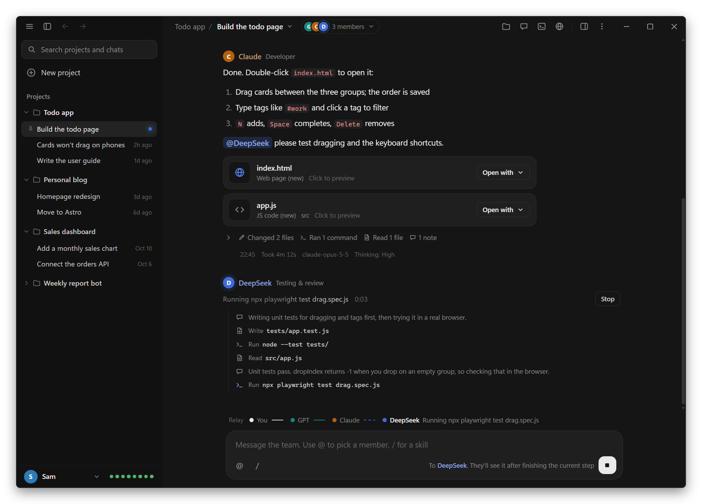
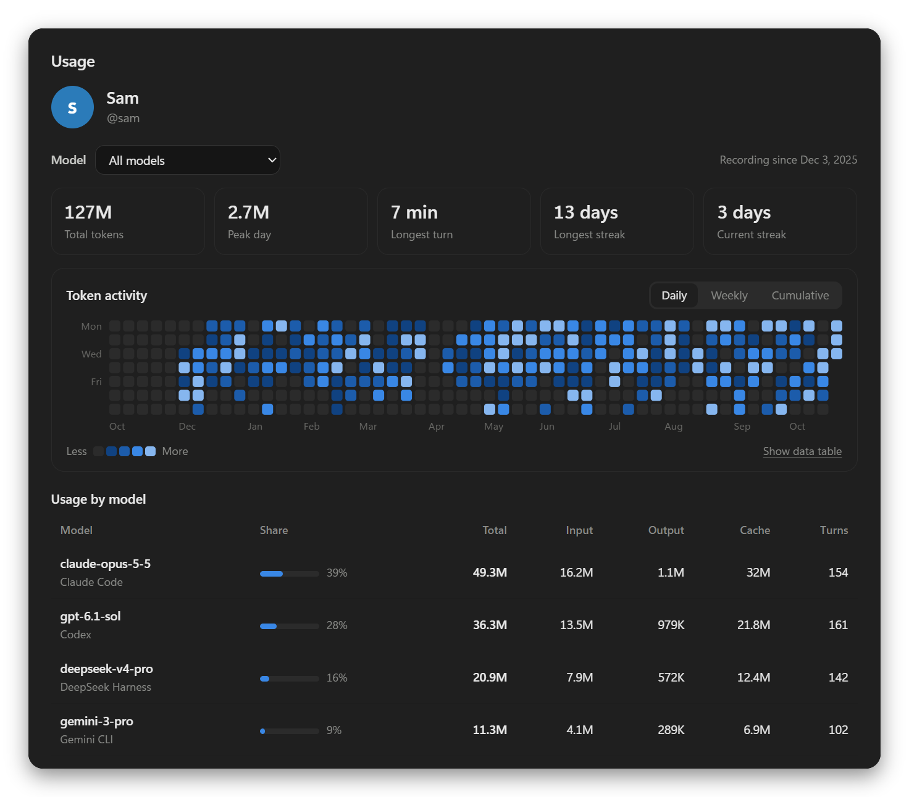
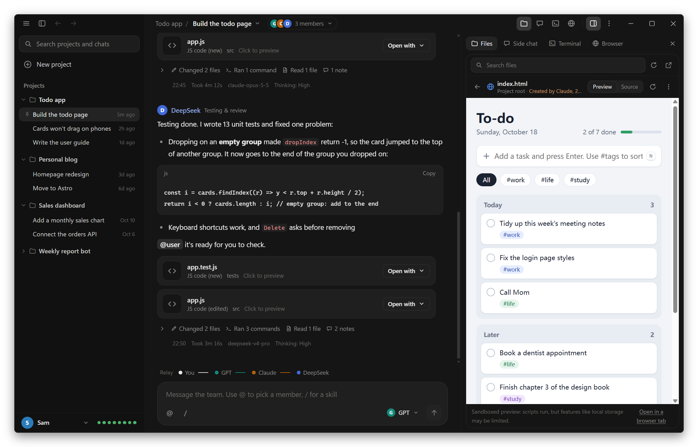
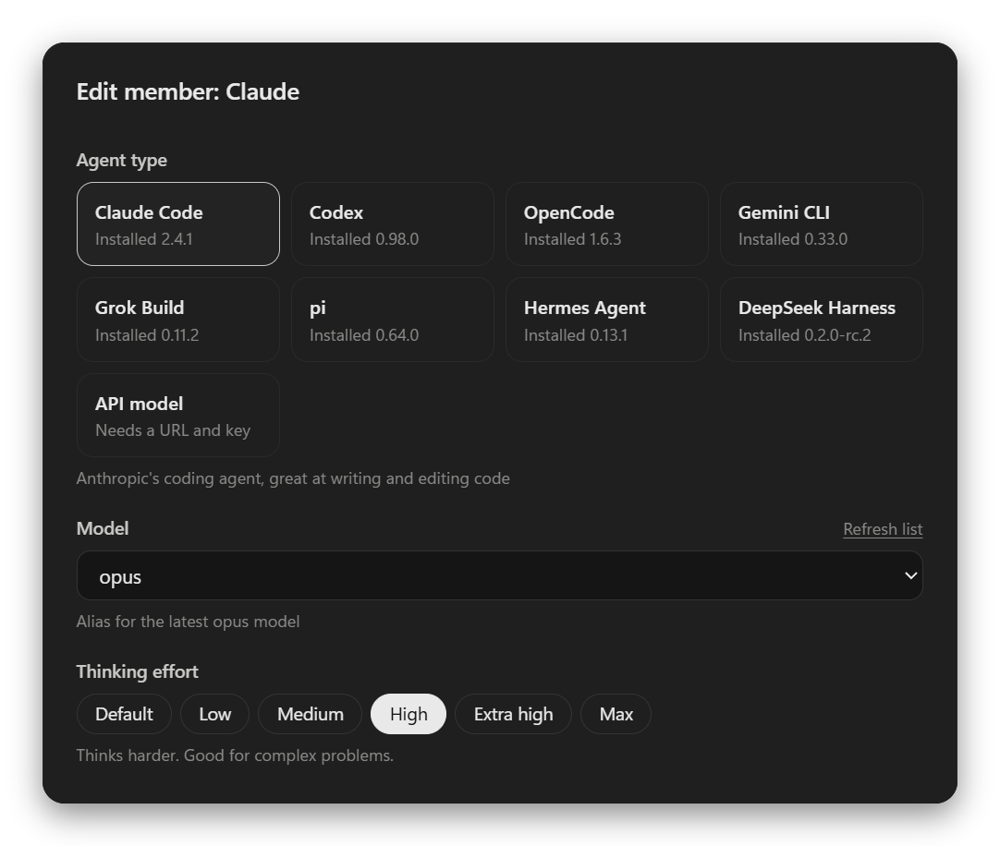

<div align="center">

<picture>
  <source media="(prefers-color-scheme: light)" srcset="build/icon-day.png">
  
</picture>

# Nightshift

Several AIs working together on one project

<p><a href="https://github.com/Lauk1z/nightshift/releases/latest">Download for Windows</a> · <a href="README.md">简体中文</a> · <a href="README.zh-Hant.md">繁體中文</a></p>

</div>

<picture>
  <source media="(prefers-color-scheme: light)" srcset="docs/screenshots/en/main-light.png">
  
</picture>

Nightshift puts Claude Code, Codex (ChatGPT), OpenCode, Gemini CLI, Grok Build, pi, Hermes Agent, DeepSeek Harness and API models such as DeepSeek, Qwen and Kimi into one "group chat". They share a project folder, split up the work and hand it off to each other.

You just describe what you want, for example `Build a to-do list web page. @GPT drafts the design first, then hands it to Claude to build.` From there:

1. **GPT** reads the request, writes the design to `docs/design.md`, and posts `@Claude please build it from the design`
2. **Claude** wakes up, reads the design, writes the code, then posts `@user ready for review`
3. You check the result, and can jump in, reassign or stop at any time

No more copying and pasting between AIs.

The name follows the appearance: in dark mode it's **Nightshift** (the icon is a moon with a `>_` prompt), working the night shift while you sleep; switch to light mode and it becomes **Dayshift** (a sun with `>_` in it). The window title, taskbar icon and About dialog change with it; the exe, installer and Start menu always say Nightshift.

<p>This page does it too: when GitHub is in light mode, the icon and screenshot at the top show Dayshift.</p>

It used to be called Agent Chat. Upgrading needs nothing from you: projects, chat history and settings stay in the same data folder.

## Installing

Download the installer from the [Releases](https://github.com/Lauk1z/nightshift/releases/latest) page on GitHub. If you build it yourself (see "Development and packaging" at the end), the `dist/` folder has these two programs; use either one:

| File | How to use it |
| --- | --- |
| `Nightshift-Setup-0.12.0.exe` | Installer. Double-click to install; it adds shortcuts to the desktop and Start menu, and it updates itself from then on (see the next section). Recommended. |
| `Nightshift-0.12.0-portable.exe` | Portable. Double-click to run, no install, so it can live on a USB stick. It unpacks itself on every start, so it opens a few seconds slower, and it doesn't update itself. |

The programs aren't code-signed, so on first run Windows may say "Windows protected your PC". Click "More info", then "Run anyway".

If you'd rather not use the exe, double-click **`start.bat`**. It opens the same interface in your browser (requires [Node.js](https://nodejs.org/) 18 or newer).

You also need at least one AI. Once a command-line tool is installed and signed in, it just has to run from a terminal:

| AI | How to install (Windows) | After installing |
| --- | --- | --- |
| Claude Code | In PowerShell: `irm https://claude.ai/install.ps1 \| iex` | Run `claude` once to sign in |
| Codex | `npm install -g @openai/codex` | Run `codex login` once |
| OpenCode | `npm install -g @opencode/cli` | Run `opencode auth login` once to set up a provider |
| Gemini CLI | `npm install -g @google/gemini-cli` | Run `gemini` once to sign in with Google, or set `GEMINI_API_KEY` |
| Grok Build | In PowerShell: `irm https://x.ai/cli/install.ps1 \| iex` | Run `grok login` once, or set `XAI_API_KEY` |
| pi | `npm install -g @earendil-works/pi-coding-agent` | Run `pi` once and sign in with `/login`, or set the provider's API key |
| Hermes Agent | In PowerShell: `iex (irm https://hermes-agent.nousresearch.com/install.ps1)` | Run `hermes model` once to choose a provider and model |
| DeepSeek Harness | `npm install -g @deepseek-ai/dsh` | Enter your DeepSeek API key in the member's settings, or set the `DEEPSEEK_API_KEY` environment variable |
| API model | Nothing to install | Any service with an OpenAI-compatible API; enter its URL, key and model name |

At the bottom left, the dots to the right of your name are the AI tools installed on this computer, one dot each: green means ready, amber means the version is too old. Click them to see each tool's version; clicking a tool that isn't installed copies its install command.

After installing or updating a tool, click "Re-detect" in that dots menu (it's also in the account menu). There's no need to restart Nightshift:

- It rereads the latest system PATH, so folders a new installer just added are found.
- It reads each tool's `--help` and only passes the options and thinking-effort levels that version supports. A tool that's too old shows "Outdated" with a hint on how to update it.
- Model lists are reloaded too.

The same goes for a new computer: install the AI tools, open Nightshift, and it finds them along with the models and thinking efforts you can choose. If Claude Code on that computer has no `settings.json`, the generic aliases fable, opus, sonnet and haiku are listed.

## Automatic updates

The installed version updates itself, so you don't have to download new releases by hand:

1. About 15 seconds after each start, Nightshift checks GitHub for a new version in the background. If you leave it running, it checks again every 6 hours.
2. If there is one, it downloads in the background without getting in the way of your work.
3. Once it's downloaded, "Restart to update" appears above your name at the bottom left (it's also in the account menu and the ☰ menu). Click it whenever it suits you: Nightshift closes, installs the new version in the background and opens again. If AI members are still working, it asks first.

Nothing is installed until you click, and quitting Nightshift doesn't install it either. You're reminded again on the next start, and a finished download isn't downloaded again.

- To check right away, use "Check for updates…" in the account menu. "About" shows the current version and the update status.
- Only the installed version updates itself. The portable version, the browser version via `start.bat` and `npm start` don't check; get new versions from [Releases](https://github.com/Lauk1z/nightshift/releases/latest).
- Updating only replaces the program files. Projects, chat history and settings live in `%APPDATA%\Agent Chat\data` and aren't touched.
- Being offline, GitHub being unreachable or a download that fails verification never interrupts you with a pop-up. It's only written to the log (`%APPDATA%\Agent Chat\logs\updater.log`) and tried again later, and "About" shows the reason in one line.
- Version 0.11.0 and earlier can't update themselves yet: install a newer version by hand once, and it updates itself from then on.

## How it works

| Concept | What it means |
| --- | --- |
| Project | A folder. A project can hold several chats, and their members all read and write files in this folder, so everyone sees changes right away. |
| Chat | A group chat inside a project. Each chat has its own members, history and settings: for example, one chat where Claude and GPT build a feature, and another where Gemini only fixes bugs. |
| Member | Each member is an AI with its own name, role and responsibilities, and belongs to one chat. Command-line AIs remember what was said before and only receive new messages next time. |
| @ relay | Whoever is @mentioned in a message goes next. When a member's reply @mentions someone else, that member wakes up; this is how the AIs talk to each other. When nobody is @mentioned, the relay ends. |
| Default recipient | Who gets your message when it doesn't @mention anyone. Pick it with the member button at the bottom right of the message box, or in "Chat settings". If a member is currently working, it goes to that member. |
| Auto-relay limit | After this many back-to-back AI handoffs (10 by default) the relay pauses until you click "Continue relay", so the AIs can't @mention each other forever. |
| One at a time | Members take turns in order, so only one is changing files at any moment and nobody overwrites anybody else. |
| Pause on error | When a member hits an error, the members queued after it wait. Click "Have it try again" to pick up from that step once it works, "Skip and continue relay", or "Stop". |

A few common patterns:

- `@GPT @Claude take a look at this bug`: the two take turns
- `@everyone what do you think?`: every member answers in turn
- When a member fails or is stopped, its message has a "try again" button

Every message is also written to `.agentchat/chat-<chat id>.md` in the project folder (one file per chat), which members read when they need to look back at earlier discussion. That folder has its own `.gitignore`, so it's never committed.

## Projects and chats

A project is a folder, and a chat is a group chat that works in that folder. To split work on one project into separate threads (a feature, a bug, the docs), open several chats in it and give each one different members.

- **New project**: pick a folder, then the members of its first chat: "Design + development", "Design + development + review", or "Blank" to add them yourself later.
- **New chat**: hover over a project in the sidebar and click +, or use "New chat" in the chat name ▾ menu in the title bar, then name the chat and pick its members in the dialog. By default it copies the members of the chat you're in, with the same models, thinking effort and permissions; you can also pick a team such as "Design + development", or "Blank". You can change them afterwards without affecting the original chat.
- **Chat names**: if you leave the name blank, the chat starts out as "New chat" and is named after your first message. To rename it, use "Rename chat…" in the chat name ▾ menu.
- **What's shared**: chats in the same project share the project folder and the terminals. History, members, side chat, the default recipient, the auto-relay limit and the delivery checklist belong to each chat.
- **Changing the folder**: do it in project settings. Every chat in the project moves with it, and members start fresh by rereading the chat history. Open terminals are still in the old folder, so they're closed too; new terminals open in the new folder.
- **Chat actions**: right-click a chat in the sidebar, or hover over it and click ⋯ on the right: pin or unpin, rename, chat settings, new chat with the same members, delete. Right-clicking a project shows the project's actions.
- **Pinning**: pinned chats stay at the top of their project, with a pin on the left.
- **Sorting**: drag a project or chat to where you want it and let go; press Esc while dragging to cancel. Chats are sorted within their own project, and pinned and unpinned chats are sorted separately. From the keyboard, press Alt+↑ / Alt+↓ on a focused project or chat to move it one place. New projects and chats go at the top.
- **Deleting**: deleting a chat removes its history and member settings; deleting a project removes all of its chats. Neither touches the files in the project folder.

When you upgrade from 0.7 or earlier, each old project becomes a project with one chat, keeping its history and members. Old projects that used the same folder are merged into one project named after the folder, and their old names carry over to its chats.

## The interface

The interface follows the Claude desktop app: a near-black background (warm white in light mode), a darker sidebar next to a lighter chat area, content in rounded cards with thin borders, and the conversation in a centered column. It follows the system's light or dark setting unless you choose one in Settings.

- **Sidebar**: search for projects and chats at the top, then "New project" and your projects. Click a project's name to expand or collapse its chats; each chat shows the time of its last message, or a blinking dot while a member is working, and pinned chats have a pin on the left. Hover over a project for + (new chat) and ⋯ (project settings, open in File Explorer, copy folder path, delete project); hover over a chat and its time turns into ⋯ (the chat's actions). Right-click shows the same menus. Projects and chats can be dragged into any order (see the previous section). At the bottom are your avatar and name (click for the account menu, see the next section), and the tool-status dots.
- **Members**: in the title bar, next to the chat name, are the chat's member avatars and how many there are; a working member's avatar has a pulsing ring. Click them for the members panel, one row per member: how it's connected (Claude Code, Codex…), its model, thinking effort and permissions, and whether it's working or queued. A member without its own model choice shows the tool's default model. Click a member to open its settings, or "Add member" to add another AI.
- **Chat**: your messages are bubbles on the right; each member's reply has its avatar, name and role above it. Hover over a message for a "Copy" button; code blocks have their own "Copy" too.
- **Conversation timeline**: a column of marks at the left edge of the chat (like in Codex), one per message you sent. The turn you're reading is the longest and brightest mark, and turns where a member hit an error are red. Move the mouse over the marks and the ones nearby grow like a magnifier, leaving a short trail that shrinks back as you move; a card next to them shows what you said, the last reply and which members took part, and slides along as you move. Click a mark to jump to that message. It appears once there are at least two turns, and hides when the chat area is too narrow.
- **Message box**: one large rounded card. The @ and / buttons at the bottom left pick a member or a skill. At the bottom right is a member picker (like the model picker in Claude): messages that don't @mention anyone go to the member it shows, and you can click it to switch to another member of the chat, which is remembered. When your message @mentions someone, it shows who the message goes to instead. While a relay is running and the box is empty, the send button turns into a stop button (■); start typing and it's a send button again.
- **Relay bar**: just above the message box, it shows where this relay has got to: solid dots are done, the working member blinks with moving stripes on its line, and hollow dots are queued.

The window has no system title bar; the title bar blends into the interface (minimize, maximize and close are still the Windows buttons, and dragging, double-click to maximize and Snap layouts all work). From left to right:

| Item | What it does |
| --- | --- |
| ☰ | Menu: new project, re-detect AI tools, zoom, reload, developer tools, check for updates (installed version), about |
| Sidebar icon | Collapse or expand the project list (Ctrl+B) |
| ← → | Go back and forward between chats you've opened (Alt+← / Alt+→, or the mouse side buttons) |
| Project name | Project actions: new chat, project settings, open in File Explorer, copy folder path, delete project |
| Chat name ▾ | Switch to another chat in the same project, or start, rename or configure a chat |
| Member avatars | Open the chat's members panel (see above) |
| Files, Side chat, Terminal, Browser | Open that page of the side panel; click again to close it |
| Panel icon | Show or hide the side panel (Ctrl+J) |
| ⋮ | Chat settings, project settings, open in File Explorer, copy folder path, and each page of the right panel |

## Account, settings and language

Click your avatar and name at the bottom left to open the account menu (just like in the Claude desktop app):

| Item | What it does |
| --- | --- |
| Settings (Ctrl+,) | Your name and avatar color, appearance (system / light / dark), interface language, send key, desktop notifications, data folder |
| Usage | How many tokens each model has used; see the next section |
| Language | 简体中文, 繁體中文 or English, applied immediately |
| User guide | This document |
| Re-detect AI tools | Look for Claude Code, Codex and OpenCode on this computer again |
| Open data folder | Projects, chat history, settings and usage records all live here (desktop app) |
| Check for updates… | Installed version only: checks for a new version right away; the result shows in "About". Once a new version has downloaded, this becomes "Restart to update" (see "Automatic updates") |
| About | Version, update status and where the data folder is |

- If you leave your name blank, your Windows user name is used. It's shown at the bottom left and on the Usage page.
- The interface language is also the AI members' default reply language. If you talk to them in another language, they switch. When you create a project, the members' responsibilities are written in this language too.
- Appearance previews as soon as you click it in Settings; "Cancel" switches it back.

## Usage

"Usage" in the account menu counts tokens by model: each time a member finishes a turn (in the group chat or the side chat), the tokens used in that turn are recorded.

<p align="center"></p>

- At the top are a few numbers: total tokens, peak day, longest turn, longest streak and current streak.
- "Token activity" shows the last year in three views:
  - **Daily**: a heatmap with one square per day; the darker the square, the more tokens.
  - **Weekly**: a bar chart with one bar per week.
  - **Cumulative**: a line that climbs over time.
- Hover over a square, bar or the line to see exact numbers; "Show data table" swaps the chart for a table.
- Below that, "Usage by model" lists each model's total, input, output, cache and turn count. Click a row (or use the "Model" menu at the top) to see only that model; the chart and the numbers above follow.

Notes:

- "Input" doesn't include cached tokens, "Cache" is cache reads plus cache writes, and "Output" includes thinking tokens.
- Where the numbers come from: Claude Code and Codex report usage in their output. OpenCode's output doesn't, so after each turn Nightshift reads it once more with `opencode api`. API models report it in the response's `usage`.
- When no model was chosen and the tool didn't say which one it used, the usage is recorded under "Default model".
- Only turns run inside Nightshift are counted. Using these tools yourself from a terminal doesn't show up here.
- Usage is recorded in `usage.jsonl` in the data folder. Clearing chat history or deleting a chat or project doesn't reduce it.

## The side panel

Like in the Claude and Codex desktop apps, it slides out from the right with four pages at the top. Drag its left edge to resize; double-click to reset. When the window is narrow, the panel floats over the chat.



**Files**

- A tree of the project folder. Click a folder to expand it, click a file to preview it in the panel.
- "Recent changes" lists files members created or edited, and who did it; changed files in the tree get a small dot in the member's color.
- Previews: web pages (run in a sandbox, with a Preview / Source switch), Markdown (can switch to source), code and text (with line numbers), images, PDFs, audio and video. Files with an unknown extension can still be viewed if they're text.
- If a member changes the file you're viewing, the preview refreshes on its own.
- Right-click a file or folder to open it with the default app, show it in its folder, insert its path into your message, copy its path, or open a terminal in that folder.
- The search box at the top finds files by name (by path when you type a `/`) and skips folders like `node_modules` and `.git`.

**Side chat**

Ask one member a question privately, such as "Which files did GPT change last round, and why?"

- Read-only: whatever its normal permissions, in the side chat a member can only look at files, never change them.
- It isn't posted to the group chat and doesn't wake anyone up. Any relay in progress keeps going, so you can ask while the team works.
- Every question includes the latest group chat, so members can answer about what just happened.
- Under each answer you can "Copy" it or "Quote in group chat" (it goes into the group chat's message box and you decide whether to send it).

**Terminal**

A real terminal (PowerShell on Windows, or PowerShell 7 if it's installed) that opens in the project folder. You can open several. Terminals belong to the project: chats in the same project share them, and each project keeps its own terminals when you switch.

- Ctrl+C copies when text is selected and interrupts the running program otherwise. Ctrl+V pastes; right-click for copy, paste and clear screen.
- URLs printed in the terminal are clickable and open in the Browser page.
- Hover over a terminal's tab to see which folder it's open in.
- Ctrl+` opens or closes the terminal.

**Browser**

An embedded browser tab with back, forward, reload, an address bar and developer tools.

- The start page lists web pages running on this computer (such as `localhost:5173` from `npm run dev`) and the `.html` files in your project; click one to open it.
- Web pages from your project open directly via `file://`, so local storage and the like work. "Open in a browser tab" in the file preview works the same way.
- It uses its own storage, separate from Nightshift itself, and denies every request for camera, location, notifications and similar permissions.
- In the browser version (`start.bat`), pages are embedded, and some sites don't allow that.

## The message box

- Type `@` to pick a member and `/` to pick a skill. Your choice becomes a single colored chip: members use their own color, skills are gray. One Backspace deletes the whole chip.
- Typing a full name and then a space also turns it into a chip.
- Enter sends and Shift+Enter starts a new line. If you often write long messages, you can switch to Ctrl+Enter to send and Enter for a new line in Settings.

## Skills with /

Typing `/` lists the skills installed on this computer and which tool each one comes from. These locations are read:

| Source | Location |
| --- | --- |
| Claude Code | `~/.claude/skills`, `~/.claude/commands`, skills in installed plugins |
| Codex | `~/.codex/skills` (including system skills), plugins enabled in `config.toml` |
| OpenCode | `~/.config/opencode/skill(s)` |
| Gemini CLI | `~/.gemini/skills` |
| Grok Build | `~/.grok/skills` (it also uses Claude's skills and the shared ones directly) |
| pi | `~/.pi/agent/skills` |
| Hermes Agent | `skills` in Hermes's data folder |
| DeepSeek Harness | `~/.dsh/skills` (it also uses the shared skills directly) |
| Shared | `~/.agents/skills` |
| In the project | `.claude/skills`, `.codex/skills`, `.opencode/skill(s)`, `.gemini/skills`, `.grok/skills`, `.pi/skills`, `.dsh/skills` and `.agents/skills` in the project folder |

For example, if you send `@GPT /frontend-design design a sign-in page`:

- If the member that picks it up has the skill installed itself, it's told to use it directly.
- If its own tool doesn't have the skill (Codex doesn't have Claude's skills, for example), Nightshift attaches the skill's instructions (`SKILL.md`) to its prompt, so every member can use every skill.

## File cards

When a member creates or edits files in a turn, file cards appear at the bottom of its message with each file's name and type. It doesn't matter whether the AI used an editing tool or a command to write the file: Nightshift compares the project folder before and after every turn.

- Click a card to preview it in the side panel's Files page (web pages, Markdown, code, text, images, PDFs and more). Word, Excel, PowerPoint files and archives open in their default app.
- The "Open with" menu has: open with default app, open with another app (Windows' "How do you want to open this file?"), show in folder, and copy file path.
- Files that run when double-clicked, such as `.exe` and `.bat`, are only shown in their folder when you "open" them, for safety.
- File links in messages, such as `[index.html](/E:/test/index.html)`, can be clicked too. A link to a file in another project's folder still previews, with the project named under the file name. A file that isn't in any project can't be previewed; you get the reason plus "Show in folder" and "Copy full path".
- Web page previews run in a sandbox, so scripts in the page can't control Nightshift.

Dependencies and build output (`node_modules`, `dist`, `build` and so on) and folders starting with `.` never show up as cards.

**When a member says it's done but the files aren't in the project**: Nightshift checks at the end of every turn. The result appears at the bottom of the message and is added to the chat history the next member reads, so teammates don't take "done" at face value.

- Files written outside the project folder with an editing tool: the message warns "N files were written outside the project folder" and lists their paths, and the matching step in the work log is tagged "outside project". Files written outside by a command can't be detected.
- A member that can change files didn't change any this turn: a small line says "No files in the project folder were changed this turn". Read-only members don't get this line.
- The collaboration rules also tell members to keep every file in the project folder, to check that the files really exist before saying they're done, and to only say tests pass after actually running them.

To check the source code, tests, EXE, logs and the rest together when the work is handed over, turn on the delivery checklist below.

## Delivery checklist

When you have members build a whole project and hand it to you at the end (say, a small program packaged as an EXE), turn on the **Delivery checklist** in Chat settings. From then on, when a member says the work is done and hands it to you, Nightshift checks the actual files and tool logs item by item and puts the result in a card under that message, instead of taking "all done, all tests pass" at face value. It's off by default and set per chat.

When it runs: the member's final reply contains a delivery report, or the relay ends with that member (it doesn't @mention another member to carry on) and it says the work is done or asks you to accept it. Handoffs between members and questions to you aren't checked, so ordinary chat isn't affected.

| Item | How Nightshift checks it |
| --- | --- |
| Source code created, in the project folder | Whether the source files in the report exist and are inside the project folder; which source files this task created or changed; whether any file was written outside the project folder |
| Automated tests actually ran and passed | Only test commands that really ran in this task according to the tool log count (pytest, unittest, npm test, go test and the like, or a test file run with python or node), along with whether that step succeeded. Tests that never ran don't count, whatever the member says; if code changed after the tests ran, they need to run again |
| The EXE and its required files exist | Whether the executable and required files in the report exist; whether the EXE is a valid Windows program, is empty, or is older than the last code change (meaning it wasn't rebuilt). Without a report, Nightshift looks in folders like dist and build. If the delivery has no executable, this item doesn't apply |
| Launch test done on Windows | Nightshift won't run programs the members built, so this one is always yours: the card shows what the member said about launching it and who started it in a command. Click the file name to find the EXE in its folder, try it, then click Pass or Fail |
| Log and delivery manifest written | Whether the log and manifest files in the report exist. Without a report, Nightshift looks through the project for files like `.log`, `logs/` and `DELIVERY.md`. Files that weren't written in this task still count, but the card says so |
| No existing project files deleted or overwritten by accident | Compared with the project folder at the start of the task: deleting an existing file fails this item; changing existing files, or a member running a command that deletes files, is left for you to confirm as intended |
| No text turned into question marks or garbled characters | Checks the text files changed in this task for runs of question marks (what Chinese text turns into when it's saved with an encoding that can't hold it), garbled characters, and files that aren't UTF-8 |

Each item is ✓ passed, ✗ failed, ? waiting for you, or – not applicable, with the evidence underneath; click a file name to preview it or show it in its folder. Items waiting for you have Pass and Fail buttons on the right; click again to undo. The check goes by files and commands, so it can get things wrong: if you're sure a failed item is actually fine, click "Pass anyway" next to it (you can undo that too).

- **Delivery report**: with the checklist on, every turn tells members what's on the checklist and the report format: source code, test command, executable, required files, launch test, log, delivery manifest, and build leftovers that can be cleaned up, one line each, "none" when there isn't one. If a member doesn't follow the format, Nightshift looks through the project itself and says so on the card.
- **Who sees the result**: the card, including your Pass and Fail clicks, is added to the chat history the next member reads, and the member that delivered sees it on its next turn too, so you can just @mention it to "fix what failed on the checklist". It's also written to the chat history file in the project.
- **Nothing gets deleted**: checking only reads files, and members are told not to delete any. Build leftovers they want to clean up (`build/`, `__pycache__/`, `*.spec` and so on) go under "build leftovers" in the report and are listed on the card; "Approve cleanup…" puts an approval in the message box for you to check and send to the member.
- **Where a task starts**: a message you send while no member is working starts a new task. Nightshift records what the project folder looked like at the start and compares against it for existing files; chats with the checklist on save that record in the data folder, so a restart midway doesn't lose it. Dependencies, build output and folders starting with `.` aren't checked.
- **It checks facts, not quality**: for tests it can confirm that the command really ran and succeeded; whether the tests cover enough and whether the program works the way you want is still up to you. Files written outside the project by a command can't be detected.
- For members to run tests and build packages themselves, give them a permission that can run commands (see Permissions below).

## Choosing each member's model and thinking effort

Click the member avatars in the title bar to open the members panel, then click a member to open its settings; "Model" and "Thinking effort" are right under "Agent type". Each member has its own settings, including members of different chats, for example GPT-6-Luna on "Low" for design and deepseek-v4-pro on "High" for development.

<p align="center"></p>

Model lists come from each tool itself. If you change a tool's configuration, click "Refresh list" here to see it:

| Agent type | Model list comes from | How thinking effort is passed |
| --- | --- | --- |
| Claude Code | Model options in `~/.claude/settings.json`, plus the aliases fable, opus, sonnet and haiku | `--effort`, plus `--settings` to override `CLAUDE_CODE_EFFORT_LEVEL` from the settings file, which would otherwise win |
| Codex | `codex debug models`; each model has its own levels | `-c model_reasoning_effort=…` |
| OpenCode | `opencode api model.list`, grouped by provider | `-m provider/model#level`, so pick a specific model before choosing a level |
| Gemini CLI | The aliases it accepts: auto, pro, flash and flash-lite (you can type a specific model name); the default is in `~/.gemini/settings.json` | Can't be set from the command line; Gemini CLI's own setting is used |
| Grok Build | `grok models` | `--effort` |
| pi | `pi --list-models`, grouped by provider; only providers you've signed in to or set a key for are listed | `--thinking`; levels above what a model supports are lowered automatically |
| Hermes Agent | Only the default model from its settings (choose models in Hermes with `hermes model`); you can also type a model name | `--reasoning` |
| DeepSeek Harness | Its built-in deepseek-flash (default) and deepseek-v4-pro; for other providers you connected in dsh, write provider/model | A temporary `--patch` sets `reasoningEffort` on `agent-default-model` (off / low / high / max). It fixes the model when a session starts, so changing the model, thinking effort or permissions starts a new session on the next turn |
| API model | The API's `/models` (click "Fetch models") | `reasoning_effort` in the request; provider-specific switches go in "Extra request parameters" |

"Default" means nothing extra is set and the tool's own setting is used. Each message records the model and thinking effort it used at the bottom.

Notes:

- Codex models marked "legacy" have newer replacements, and some accounts can't use them. For example, accounts signed in with ChatGPT can't use gpt-5.5 and get an error straight away.
- Higher thinking effort means slower answers and more usage. "Low" is plenty for simple handoffs and greetings.

## Permissions

Each member has its own setting:

| Agent type | Read-only | Can edit files (default) | Full access |
| --- | --- | --- | --- |
| Claude Code | Can only read files | Can edit files, can't run commands | Can run any command |
| Codex | Read-only sandbox | Can edit files; commands run in a sandbox | Sandbox off |
| OpenCode | Plan mode | Follows OpenCode's own settings | Approves everything |
| Gemini CLI | Tools that need approval never run | Edits approved automatically, can't run commands | yolo mode, approves everything |
| Grok Build | dontAsk mode: only read-only tools and commands | Edits approved automatically; commands that need approval don't run | always-approve, approves everything |
| pi | Only read, grep, find and ls | Adds edit and write, can't run commands | Default tools, can run any command |
| Hermes Agent | Removes command-line tools and asks it not to change files (Hermes has no read-only file tools, so this can't be fully enforced) | Default tools; dangerous commands don't run without approval | `--yolo`, runs dangerous commands too |
| DeepSeek Harness | Read-only sandbox (`DSH_PERMISSION_MODE=read-only`) | Can change files in the project folder; commands run in a sandbox, and anything that needs approval doesn't run | Sandbox off (`danger-full-access`) |
| API model | Can only list and read files | Can read and write files | Can also run commands |

If you want the developer member to install dependencies and run tests itself, give it "Full access". Only do this for projects you trust.

## Adding an API model

Choose **API model** when you click "Add member", then:

1. Pick an address from "Common services", or type your own:
   - DeepSeek: `https://api.deepseek.com/v1`
   - Qwen (Alibaba Cloud Model Studio): `https://dashscope.aliyuncs.com/compatible-mode/v1`
   - Kimi: `https://api.moonshot.cn/v1`
   - Local Ollama: `http://127.0.0.1:11434/v1`
2. Enter the API key and the model name

API models can't read or write files on their own, so Nightshift gives them a set of file tools that only work inside the project folder. This needs a model that supports tool calls (function calling). If yours doesn't, uncheck "Let it read and write project files" in the member's settings and it will only take part in the discussion.

DeepSeek's newer models sometimes write their tool calls as plain text (the DSML format, like `<｜DSML｜function_calls>`) that the API didn't turn into real tool calls. Nightshift recognizes these and runs them anyway, without showing the markup. If the markup is incomplete, the turn is reported as an error instead of being treated as a finished reply.

## Data and privacy

- Projects, chats, chat history, member settings, app settings and usage records are all stored on this computer, and so are API keys:
  - Desktop app: `%APPDATA%\Agent Chat\data` (shared by the installer and portable versions; it keeps the folder name from before the rename, so your data carries over)
  - Browser version via `start.bat`: the `data/` folder next to it
- The desktop app also runs a small service inside the program that only listens on `127.0.0.1`, and it rejects requests from other websites
- Projects are stored in `data/projects/<project id>/project.json`; chats in `data/rooms/<chat id>/`, with members in `room.json` and history in `messages.jsonl`
- Deleting a chat or project only removes those records; your project folder isn't touched
- When the desktop app's window is in the background, you get a Windows notification when a member @mentions you, hits an error or finishes a relay
- The side chat is stored in `data/rooms/<chat id>/side.jsonl` and never written to the chat log in the project folder
- App settings are stored in `data/settings.json` and usage in `data/usage.jsonl` (only numbers, model names and member names, no conversation content)
- The built-in terminal runs with your own permissions, just like a PowerShell window you open yourself, and closes when Nightshift closes
- The installed version contacts github.com to check for and download new versions (see "Automatic updates"). The requests contain no projects, chat history or account details, only a random ID (electron-updater uses it to roll out new versions in stages; it's stored in `%APPDATA%\Agent Chat\.updaterId`). Downloaded installers are kept in `%LOCALAPPDATA%\agent-chat-updater`

## FAQ

**A member keeps failing with authentication or connection errors?**
Nightshift runs the `claude`, `codex`, `opencode`, `gemini`, `grok`, `pi`, `hermes` and `dsh` commands on your computer, using their own sign-in and configuration. First check that something like `claude -p "hello"` or `gemini -p "hello"` answers normally in a terminal.

**Which model is the "Claude" member actually using?**
Look at the model name at the bottom of its messages. With no model chosen, it depends on Claude Code's own configuration (`~/.claude/settings.json`). If you route Claude Code to another model with a proxy such as CC Switch, that shows here too.

**What if members are still working when I close the window?**
You're asked first whether to stop them. If you confirm, they're stopped before the app quits.

**The AIs won't stop?**
Click "Stop relay". You can also lower the "Auto-relay limit" in chat settings.

**Ctrl+R doesn't reload the interface?**
In the terminal, Ctrl+R searches command history, so reloading the interface is Ctrl+Shift+R instead, or "Reload" in the ☰ menu.

**Usage doesn't match what the tool itself reports?**
"Usage" only counts turns run inside Nightshift. Tools also count cache differently; Nightshift normalizes everything to input (without cache) + cache + output, so totals can differ slightly from a tool's own numbers.

**Changing the port of the browser version?**
Run `node server/index.js --port 4000 --open`.

**Automatic updates never seem to happen?**
Open "About" and look at the "Updates" row: it shows the current status or why it didn't work (offline, GitHub rate limits, no `latest.yml` in the latest release…). The full record is in `%APPDATA%\Agent Chat\logs\updater.log`. The portable and browser versions don't update themselves.

## Development and packaging

```bash
npm install
```

```bash
npm start
```

`npm start` opens the desktop app with Electron; `npm run web` opens the browser version.

```bash
npm test
```

Runs the tests. No network access and no real AI calls are needed.

```bash
npm run dist
```

Rebuilds the installer and portable exe into `dist/`, plus the `latest.yml` and `Nightshift-Setup-<version>.exe.blockmap` that automatic updates need. It only builds; nothing is uploaded to GitHub. Before packaging it copies xterm.js, used by the terminal, into `public/vendor/` (`npm run vendor`). The icon is generated with `npm run icon` (`scripts/make-icon.js`).

To publish a new version:

1. Bump `version` in `package.json`. Automatic updates compare versions with it, so it must be higher than the previous one (say 0.11.0 → 0.12.0).
2. Run `npm run dist`.
3. Create a GitHub Release tagged `v` plus the version (such as `v0.12.0`), upload all of the files below from this build's `dist/`, and publish it as a regular release. Automatic updates only look at the latest regular release ("Latest"); drafts and pre-releases don't count.

| File | Purpose |
| --- | --- |
| `Nightshift-Setup-<version>.exe` | The installer. It's also what automatic updates download |
| `latest.yml` | Tells installed copies of Nightshift the newest version number, the installer's file name and its checksum. **Forget it and nobody gets this update** ("About" then says "The latest release on GitHub doesn't offer automatic updates yet") |
| `Nightshift-Setup-<version>.exe.blockmap` | For incremental updates: next time, computers running this version only download the parts that differ. Without it updates still work, they just download the whole installer (over 100 MB) |
| `Nightshift-<version>-portable.exe` | The portable version (optional) |

Always upload the `latest.yml` and `.blockmap` this `npm run dist` generated, never edited old ones. Earlier releases only uploaded the installer, which is why 0.11.0 and earlier can't update themselves and need one manual install of a newer version.

The built-in terminal uses [@lydell/node-pty](https://www.npmjs.com/package/@lydell/node-pty), which ships prebuilt binaries, so no build tools are needed.

```
electron/
  main.js           Desktop main process: starts the service, immersive title bar, embedded browser, folder picker, notifications, quit confirmation
  updater.js        Automatic updates (electron-updater, from GitHub Releases, installed version only)
  preload.js        The few native features exposed to the interface
server/
  index.js          HTTP service, API and SSE push; start() is used by the desktop app
  orchestrator.js   Relay scheduling: queue, @ routing, auto limit, stop
  side.js           Side chat: ask one member privately, read-only, kept out of the group chat
  terminal.js       Built-in terminal (node-pty); output is pushed to the interface over SSE
  prompt.js         Collaboration protocol, prompts and @ parsing
  models.js         Reads each tool's model list and thinking-effort levels
  skills.js         Reads the skills installed on this computer and hands their instructions to members
  files.js          Before/after comparison of project files (file cards), file tree and search, opening files
  settings.js       App settings (name, appearance, language, send key, notifications)
  usage.js          Token usage records and summaries
  i18n.js           Server text shown to users (errors, system messages) follows the language setting
  store.js          Local storage: projects, chats and history; upgrades data from older versions
  proc.js           Starts and stops command-line tools reliably on Windows
  adapters/         One file per AI: claude, codex, opencode, gemini, grok, pi, hermes, dsh (DeepSeek Harness), openai (compatible APIs)
public/             Interface (plain JS, no build step)
  app.js            Main interface: title bar, projects and chats, members panel, group chat, message box
  panel.js          Side panel: files, side chat, terminal, browser
  account.js        Account menu, settings, the Usage page and the update prompt
  i18n.js           Interface language: looks up text by its Simplified Chinese original
  i18n/             Dictionaries: en.json (written by hand), zh-Hant.json (generated by scripts/i18n-hant.js)
  vendor/xterm/     Terminal UI (xterm.js, copied by scripts/vendor.js)
scripts/make-icon.js Generates the app icon
scripts/vendor.js   Copies xterm.js into public/vendor
scripts/i18n-*.js   Translation helpers: find untranslated text, check dictionaries, generate Traditional Chinese
scripts/screenshots/ Generates the README screenshots (npm run screenshots)
test/run.js         Tests
```

All interface text is wrapped in `tr('Simplified Chinese original')`, and English and Traditional Chinese are looked up by that original in the dictionaries in `public/i18n/`. After adding new text, run:

```bash
node scripts/i18n-keys.js
```

It lists any translations missing from `en.json` (add them), then run `node scripts/i18n-hant.js` to regenerate the Traditional Chinese dictionary and user guide (run `npm install` first; it uses opencc-js). `npm test` also checks that the dictionaries are complete.

The user guide comes in three versions, and "User guide" in the account menu shows the one for the interface language: `README.md` (Simplified Chinese, the original), `README.en.md` (English; update it when the original changes) and `README.zh-Hant.md` (Traditional Chinese, generated, don't edit it by hand). Content meant only for GitHub (the icon, screenshots and language links at the top) is written as HTML on lines of its own, and the in-app user guide leaves those lines out. Screenshots are in `docs/screenshots/<language>/`.

After changing the interface, run `npm run screenshots` to regenerate these screenshots: it starts the desktop app with demo data and stand-in command-line tools, leaves your real data and settings alone, and makes no AI calls. To retake only some of them, add screenshot names or languages, such as `npm run screenshots -- usage en`.

To add a new AI tool, add a file in `server/adapters/` that implements `run({ agent, cwd, prompt, sessionId, emit })` and returns `{ done, cancel }`. `codex.js` is a good example to follow.
