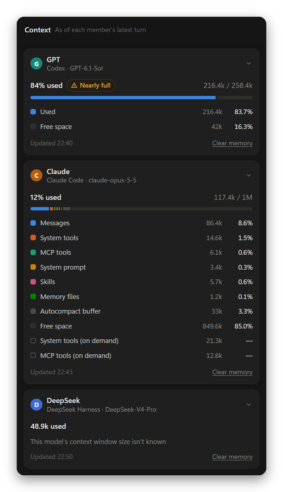

<div align="center">

<picture>
  <source media="(prefers-color-scheme: light)" srcset="build/icon-day.png">
  
</picture>

# Nightshift

Several AIs working together on one project

<p><a href="https://github.com/Lauk1z/nightshift/releases/latest">Download for Windows</a> · <a href="README.md">简体中文</a> · <a href="README.zh-Hant.md">繁體中文</a></p>

</div>

<picture>
  <source media="(prefers-color-scheme: light)" srcset="docs/screenshots/en/main-light.png">
  
</picture>

Bring command-line AIs like Claude Code, Codex, OpenCode and Gemini CLI, and API models like DeepSeek and Qwen, into one group chat. They share a project folder and hand work to each other with @mentions: you say what you need, they split it up, and you can step in or stop them at any time.

It's called Nightshift in dark mode and Dayshift in light mode.

## Install

1. Download `Nightshift-Setup-<version>.exe` from [Releases](https://github.com/Lauk1z/nightshift/releases/latest) and install it (`-portable.exe` runs without installing). If Windows says it protected your PC, click "More info" → "Run anyway".
2. Install and sign in to at least one AI tool:

| AI | Install | Sign in |
| --- | --- | --- |
| Claude Code | `irm https://claude.ai/install.ps1 \| iex` | `claude` |
| Codex | `npm install -g @openai/codex` | `codex login` |
| OpenCode | `npm install -g @opencode/cli` | `opencode auth login` |
| Gemini CLI | `npm install -g @google/gemini-cli` | `gemini`, or set `GEMINI_API_KEY` |
| Grok Build | `irm https://x.ai/cli/install.ps1 \| iex` | `grok login`, or set `XAI_API_KEY` |
| pi | `npm install -g @earendil-works/pi-coding-agent` | `/login` inside `pi` |
| Hermes Agent | `iex (irm https://hermes-agent.nousresearch.com/install.ps1)` | `hermes model` |
| DeepSeek Harness | `npm install -g @deepseek-ai/dsh` | Enter the API key in member settings, or set `DEEPSEEK_API_KEY` |
| API model | Nothing to install | Enter the endpoint, key and model name |

The plug icon at the bottom left shows which tools are ready. After installing a new one, click "Re-detect"; no restart needed.

The installed version updates itself: once a new version has downloaded in the background, "Restart to update" appears at the bottom left. The portable version doesn't update itself. To skip the exe, double-click `start.bat` to use it in your browser (needs [Node.js](https://nodejs.org/) 18 or later).

## Getting started

Nightshift opens on a new chat: type what you need and send it, no folder required. Every AI installed on this computer is a member, with no roles assigned. Pick who goes first at the bottom right of the message box, and hover over it to switch models; your next new chat starts with the same choices. The chat's files go in a folder Nightshift makes for it. "New chat" in the sidebar brings you back here any time.

To work on your own code, click "New project" and pick a folder. A project can hold several chats that share the folder, each with its own members and history.

Whoever you @mention in a message goes next. When a member's reply @mentions someone else, that member wakes up; when nobody is mentioned, the relay ends. For example:

- `@GPT design it first, then hand it to @Claude to build`
- `@everyone what do you think?`

Messages that don't @mention anyone go to the member shown at the bottom right of the message box. After 10 back-to-back handoffs between members (you can change this in chat settings), the relay pauses until you click "Continue relay". When a member fails, the ones queued after it wait; you can have it try again or skip it.

**When a member needs you** (choose in chat settings):

- **Manual review** (default): when a member @mentions you with a question, the relay stops there. Reply to it, or click "Approve and continue".
- **Automatic**: a reviewer model looks first (a member of the chat, or a dedicated model; it's read-only). It answers low-risk requests for you and hands you only high-risk actions, things you have to do yourself, or anything it's unsure about.
- **Full autonomy**: the relay never stops; members make their own calls.

**Attachments**: drag files or folders into the chat area, click + at the bottom left of the message box, or paste a screenshot or copied files into the message box (Ctrl+V). Files from outside the project are copied into `.agentchat/attachments/` in the project so every member can read them; the originals are never changed.

**Changing your mind**:

- Under a member's reply, "Answer again" has it redo that reply with a fresh approach; the original stays.
- Your own messages have "Edit and resend": the edited text goes out as a new message, the original is marked Edited, and members go by the new one.
- When a member changed files in a turn, its reply has "Undo this turn's changes": new files are removed, changed files reverted and deleted files put back. Files changed since are left alone, and "Restore" brings the changes back. Before each turn Nightshift keeps a copy of the project's files (files over 2 MB aren't kept, so their changes can't be undone).

## The interface

- **Sidebar**: search, New chat, New project, and your projects and chats below. Chats can be pinned and dragged into order; right-click for their actions.
- **Title bar**: the project name, the chat name ▾ (switch chats), member avatars (the members panel), and on the right the five pages of the side panel.
- **Side panel**:
  - **Files**: the project's file tree and previews (web pages, Markdown, code, images, PDF…); files a member changed are marked with who changed them.
  - **Side chat**: ask one member a question; read-only, and it stays out of the group chat.
  - **Terminal**: PowerShell, opened in the project folder.
  - **Browser**: open web pages running on this computer, or the project's `.html` files.
  - **Context**: how much of each member's context window it has used in this chat, as of its latest turn. Claude Code also breaks it down into messages, system tools, MCP tools, system prompt and skills; Gemini CLI, Grok and Hermes don't report it. When a member is nearly full, "Clear memory" on its card starts it fresh.
- Files a member created or changed in a turn are listed under its message; click one to preview it.


<p align="center"></p>

## Members

Click the member avatars in the title bar, then a member, to change its name, role, agent type, model, thinking effort and permissions. Every chat has its own members.

<p align="center"></p>

- **Model and thinking effort**: the lists come from each tool; "Default" keeps the tool's own setting. You can also switch models from the member picker at the bottom right of the message box: hover over a member.
- **Permissions**: read-only, edit files (default), ask before running commands (Claude Code and API models: they stop before each command and only run it if you allow it), or full access (can run any command; only turn it on for projects you trust). Member settings explain what each level means for that tool.
- **API models**: choose "API model" as the agent type and enter the endpoint (DeepSeek, Qwen, Kimi and local Ollama are built in), your key and the model name. To read and write files, the model must support tool calling. Under "More settings" you can enter its context window: the Context page uses it to show how much is used, and a model with a small window gets less chat history each turn.

## More

- **Skills**: type `/` to pick a skill installed on this computer. If a member's own tool doesn't have that skill, its instructions are sent along.
- **Delivery checklist**: turn it on in chat settings. When a member delivers its work, Nightshift checks the source code, whether tests actually ran and passed, the EXE, logs and existing files, and shows the result as a card; the launch test is left to you.
- **Usage**: "Usage" in the account menu counts tokens by model, with a heatmap of the past year and a breakdown per model.
- **Search chat history**: type two or more characters in the sidebar search and matching messages from every chat appear below; click one to jump to it.
- **Export**: "Export as Markdown" in a chat's menu (right-click it in the sidebar, or ⋯ in the title bar) saves the whole chat to a file.

<p align="center"></p>

## Data

- Everything stays on this computer in `%APPDATA%\Agent Chat\data` (`data/` for the browser version). "Open data folder" in the account menu opens it.
- Deleting a chat or project only deletes its history; files in the project folder are never touched. A chat that isn't part of a project is deleted together with its folder (it goes to the Recycle Bin).
- The server only listens on `127.0.0.1`. The installed version contacts github.com to check for updates, without sending any project or chat content.

## FAQ

**A member keeps failing?** Nightshift runs the `claude`, `codex` and other commands on your computer with their own sign-ins. First check that something like `claude -p "hello"` answers in a terminal.

**Rate limits or a busy API?** If it happens before a member has done any work, Nightshift waits and retries on its own (30 seconds, 2 minutes, 5 minutes); click stop to skip the wait. Running out of quota isn't retried.

**The AIs won't stop?** Click stop (■) where the send button is, or lower the "Auto-relay limit" in chat settings.

**How do I reload the interface?** Ctrl+Shift+R, or "Reload" in the ☰ menu.

## Development

```bash
npm install
```

```bash
npm start
```

`npm start` opens the desktop app, `npm run web` the browser version, `npm test` runs the tests (offline, no real AI calls), and `npm run dist` builds into `dist/`.

To release: bump `version` in `package.json`, run `npm run dist`, create a GitHub Release tagged `v` plus the version, upload `Nightshift-Setup-<version>.exe`, `latest.yml` and the `.blockmap` together, and publish it as a full release. Without `latest.yml`, installed copies won't get the update.

Interface text is wrapped in `tr('Simplified Chinese source')`. After adding text, run `node scripts/i18n-keys.js` to list missing English translations and add them to `public/i18n/en.json`, then run `node scripts/i18n-hant.js` to regenerate the Traditional Chinese dictionary and guide. After interface changes, `npm run screenshots` regenerates the screenshots in this guide.
