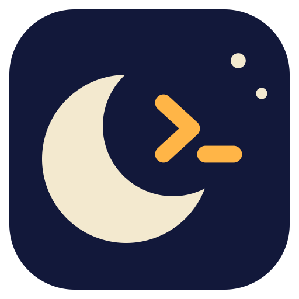
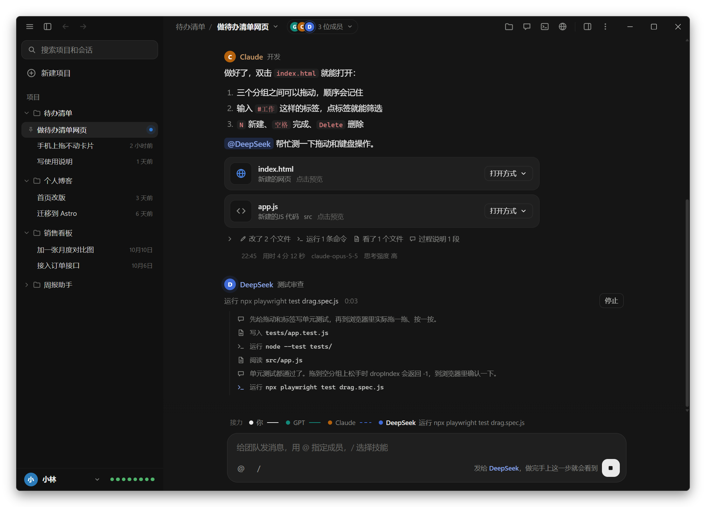
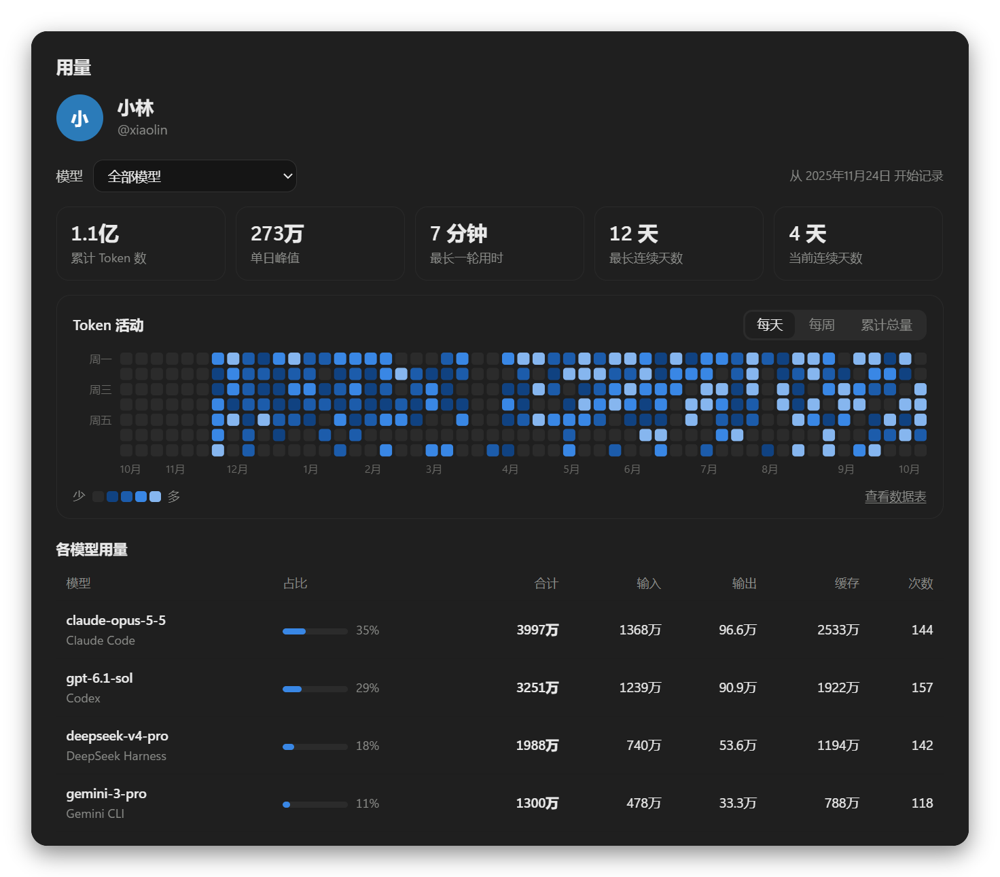
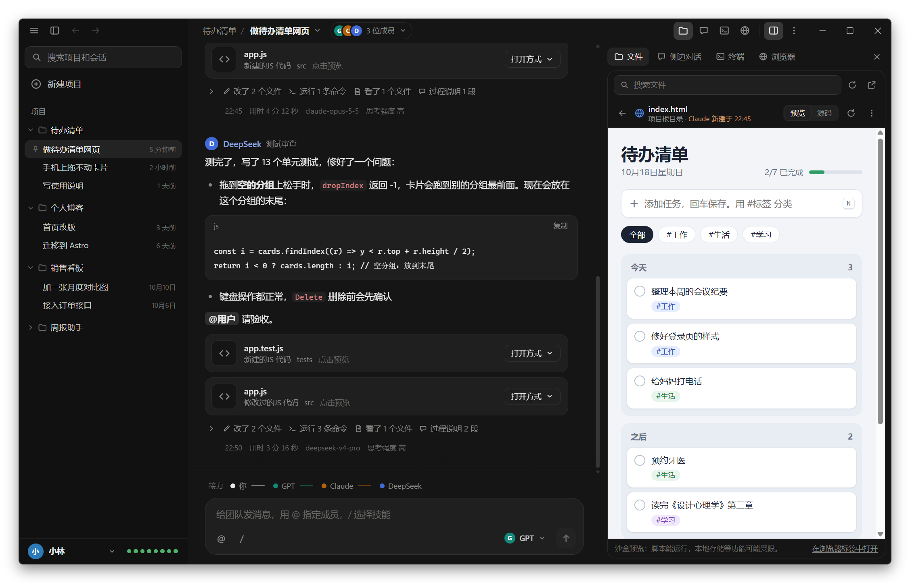
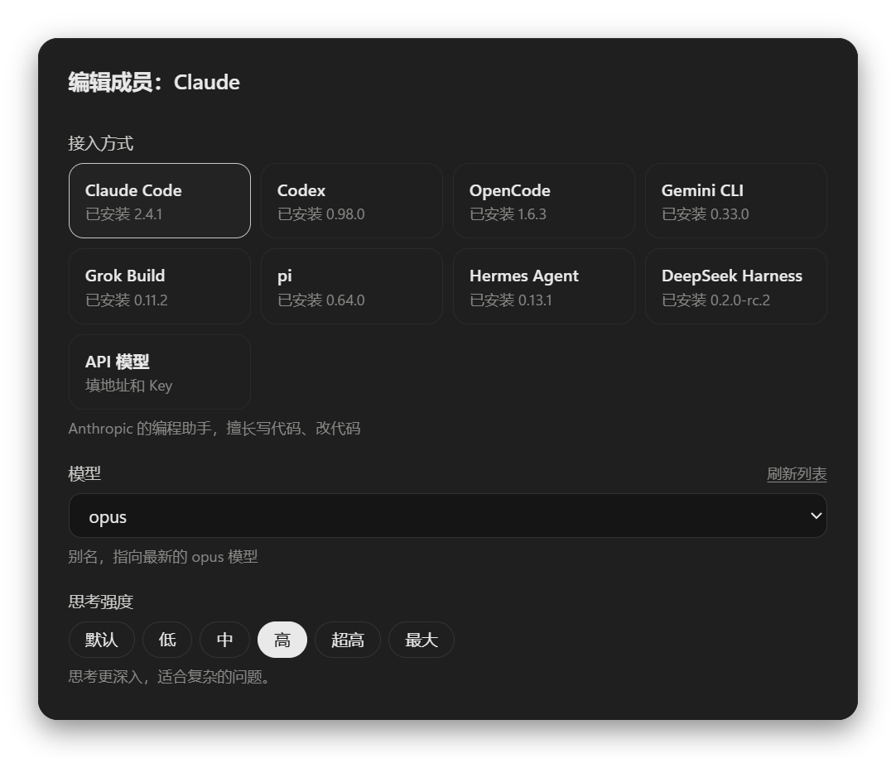

<div align="center">

<picture>
  <source media="(prefers-color-scheme: light)" srcset="build/icon-day.png">
  
</picture>

# Nightshift

让多个 AI 在同一个项目里协作

<p><a href="https://github.com/Lauk1z/nightshift/releases/latest">下载 Windows 安装版</a> · <a href="README.en.md">English</a> · <a href="README.zh-Hant.md">繁體中文</a></p>

</div>

<picture>
  <source media="(prefers-color-scheme: light)" srcset="docs/screenshots/zh-Hans/main-light.png">
  
</picture>

把 Claude Code、Codex（ChatGPT）、OpenCode、Gemini CLI、Grok Build、pi、Hermes Agent、DeepSeek Harness，以及 DeepSeek、通义千问、Kimi 这类 API 模型拉进同一个「群聊」，让它们共用一个项目文件夹、自己分工、互相交接。

你只要提需求，比如 `做一个待办清单网页，@GPT 先出设计，再交给 Claude 实现`。之后的流程是：

1. **GPT** 读需求，把设计方案写进 `docs/design.md`，在群里 `@Claude 请按方案实现`
2. **Claude** 被唤醒，读设计、写代码，完成后 `@用户 请验收`
3. 你看结果，随时插话、指派、叫停

不用再在几个 AI 之间来回复制粘贴。

名字跟着外观换：深色时叫 **Nightshift**（夜班，图标是月亮里亮着提示符 `>_`），你去睡觉，它们值夜班；切到浅色就变成 **Dayshift**（日班，图标是太阳里写着 `>_`）。窗口标题、任务栏图标和「关于」里的名字都会跟着变；exe、安装包和开始菜单里的名字固定是 Nightshift。

<p>在 GitHub 上看这份说明也一样：GitHub 是浅色外观时，最上面的图标和截图就是 Dayshift。</p>

以前叫 Agent Chat。从旧版本升级不用做任何事：项目、聊天记录和设置都还在原来的数据文件夹里。

## 安装

到 GitHub 的 [Releases](https://github.com/Lauk1z/nightshift/releases/latest) 页面下载安装版。自己打包的话（见最后的「开发和打包」），`dist/` 文件夹里会有下面两个程序，选一个用：

| 文件 | 用法 |
| --- | --- |
| `Nightshift-Setup-0.11.0.exe` | 安装版。双击安装，会在桌面和开始菜单建快捷方式。推荐用这个。 |
| `Nightshift-0.11.0-portable.exe` | 免安装版。双击直接运行，可以放在 U 盘里随身带。每次启动要先解压，会比安装版慢几秒。 |

程序没有数字签名，第一次运行时 Windows 可能提示「Windows 已保护你的电脑」。点「更多信息」→「仍要运行」即可。

不想用 exe 的话，双击 **`start.bat`** 也行。它会在浏览器里打开同样的界面（需要装 [Node.js](https://nodejs.org/) 18 或更新版本）。

还需要至少一个 AI。命令行工具装好、登录好以后，在命令行里能直接运行就行：

| AI | 怎么装（Windows） | 装好以后 |
| --- | --- | --- |
| Claude Code | PowerShell 里运行 `irm https://claude.ai/install.ps1 \| iex` | 运行一次 `claude` 登录 |
| Codex | `npm install -g @openai/codex` | 运行一次 `codex login` |
| OpenCode | `npm install -g @opencode/cli` | 运行一次 `opencode auth login` 配好提供商 |
| Gemini CLI | `npm install -g @google/gemini-cli` | 运行一次 `gemini` 登录 Google 账号，或者设置 `GEMINI_API_KEY` |
| Grok Build | PowerShell 里运行 `irm https://x.ai/cli/install.ps1 \| iex` | 运行一次 `grok login`，或者设置 `XAI_API_KEY` |
| pi | `npm install -g @earendil-works/pi-coding-agent` | 运行一次 `pi`，用 `/login` 登录，或者设置对应提供商的 API Key |
| Hermes Agent | PowerShell 里运行 `iex (irm https://hermes-agent.nousresearch.com/install.ps1)` | 运行一次 `hermes model` 选好提供商和模型 |
| DeepSeek Harness | `npm install -g @deepseek-ai/dsh` | 在成员设置里填 DeepSeek 的 API Key，或者设置环境变量 `DEEPSEEK_API_KEY` |
| API 模型 | 不用装 | 任何兼容 OpenAI 接口的服务，填地址、Key 和模型名即可 |

左下角你的名字右边的小点是这台电脑上装好的 AI 工具，一个点一个：绿色是能用，琥珀色是版本太旧。点一下能看到每个工具的版本；没装的工具点一下会复制它的安装命令。

之后装了新工具或者升级了版本，点那排小点里的「重新检测」就行（账户菜单里也有），不用重启 Nightshift：

- 它会重新读取系统最新的 PATH，安装程序刚加进去的文件夹也能找到。
- 它会读一遍每个工具的 `--help`，只传当前版本支持的参数和思考强度档位。版本太旧的工具会显示「版本太旧」并提示怎么升级。
- 模型列表也会重新读取。

换一台电脑装 Nightshift 也一样：装好 AI 工具后打开 Nightshift，就能识别它们，并列出能选的模型和思考强度。那台电脑上的 Claude Code 没有自己的 `settings.json` 也没关系，会列出 fable、opus、sonnet、haiku 这几个通用别名。

## 工作原理

| 概念 | 说明 |
| --- | --- |
| 项目 | 一个文件夹。项目里可以开好几个会话，它们的成员都在这个文件夹里读写文件，彼此的改动立刻可见。 |
| 会话 | 项目里的一个群聊。每个会话有自己的成员、聊天记录和设置，互不影响：比如一个会话让 Claude 和 GPT 写新功能，另一个会话让 Gemini 专门修 bug。 |
| 成员 | 每个成员是一个 AI，有自己的名字、角色和职责说明，属于某一个会话。命令行类 AI 会记住之前聊过的内容，下次只接收新消息。 |
| @ 接力 | 消息里 `@谁`，谁就接着做。成员的回复里 @ 了别人，别人就被唤醒，AI 之间就是这样自己交流的。没有 @ 任何人时，接力自然结束。 |
| 默认接收人 | 你的消息没有 @ 人时交给谁。在输入框右下角的成员按钮里选，「会话设置」里也能改。如果有成员正在工作，就交给它。 |
| 自动接力上限 | AI 之间连续交接达到这个轮数（默认 10）会暂停，等你点「继续接力」，防止它们无限地互相 @。 |
| 一次一个 | 成员按顺序轮流执行，同一时间只有一个在改文件，避免互相覆盖。 |
| 出错就暂停 | 某个成员运行出错时，排在它后面的成员先不做。可以点「让它再试一次」，成功后从这一步接着往下做；也可以「跳过，继续接力」，或者「停止」。 |

几个常用写法：

- `@GPT @Claude 各自看一下这个 bug`：两人按顺序轮流处理
- `@所有人 说说你的想法`：每位成员轮流发言
- 成员出错或被中止时，消息下面有「让它再试一次」

每条消息也会写进项目文件夹里的 `.agentchat/chat-<会话id>.md`（一个会话一个文件），成员需要回顾早期讨论时会去读。这个文件夹自带 `.gitignore`，不会被提交到 git。

## 项目和会话

项目就是一个文件夹，会话是在这个文件夹里开的一个群聊。一个项目想分几条线做（写功能、修 bug、写文档），就在里面多开几个会话，每个会话配不同的成员。

- **新建项目**：选一个文件夹，再选第一个会话的成员：「设计 + 开发」「设计 + 开发 + 审查」，或者「空白」之后自己加。
- **新建会话**：鼠标移到左边的项目上点 +，或者用标题栏会话名 ▾ 菜单里的「新建会话」，在弹出的窗口里起名字、选成员。成员默认照搬当前会话的，模型、思考强度、权限都一样；也可以选「设计 + 开发」这样的团队，或者「空白」。建好以后可以单独改，不影响原来的会话。
- **会话名字**：新建时没填名字的话，先叫「新会话」，你发第一条消息时会用这条消息自动起名字。想改就用会话名 ▾ 菜单里的「重命名会话…」。
- **哪些是共用的**：同一个项目里的会话共用项目文件夹和终端；聊天记录、成员、侧边对话、默认接收人和自动接力上限是每个会话自己的。
- **换文件夹**：在项目设置里改，项目里所有会话一起换过去，成员会从头开始（重新读一遍聊天记录）。
- **会话的操作**：右键左边栏里的会话，或者鼠标移上去点右边的 ⋯：置顶 / 取消置顶、重命名、会话设置、用相同的成员新建会话、删除。右键项目弹出的是项目的操作。
- **置顶**：置顶的会话排在项目里最前面，左边有一个图钉。
- **排序**：按住项目或会话拖到想要的位置，松手就记住了；拖的时候按 Esc 取消。会话只在自己的项目里排，置顶的和没置顶的各排各的。用键盘的话，焦点在项目或会话上时按 Alt+↑ / Alt+↓ 挪一格。新建的项目和会话放在最上面。
- **删除**：删除会话只删它的聊天记录和成员设置；删除项目会删掉它里面所有的会话。都不会动项目文件夹里的文件。

从 0.7 或更早的版本升级时，原来的每个项目会自动变成一个项目加一个会话，聊天记录和成员都保留。用同一个文件夹的几个旧项目会合并成一个项目（用文件夹的名字），原来的项目名留给里面的各个会话。

## 界面

界面照着 Claude 桌面版的样子做：近黑的底色（浅色模式是暖白），侧边栏和对话区一深一浅，内容放在带细边框的圆角卡片里，对话在中间一栏。跟着系统的深浅色自动切换。

- **左边栏**：最上面可以搜索项目和会话，下面是「新建项目」和项目列表。点项目名展开或收起它里面的会话，会话右边是最近一条消息的时间，有成员在工作时是一个闪动的点，置顶的会话左边有图钉。鼠标移到项目上，右边会出现 +（新建会话）和 ⋯（项目设置、在文件管理器中打开、复制文件夹路径、删除项目）；移到会话上，时间换成 ⋯（会话的操作）。右键也是同样的菜单。项目和会话都可以拖动排序（见上一节）。最底下是你的头像和名字（点开是账户菜单，见下一节），右边的小点是本机 AI 工具的状态。
- **成员**：标题栏里会话名的右边是这个会话的成员头像和人数，正在工作的成员头像外有一圈在闪。点开是成员面板，每个成员一行：接入方式（Claude Code、Codex……）、模型、思考强度、权限，以及它正在工作还是在排队。没单独选模型的，显示那个工具自己设置里的默认模型。点成员打开它的设置，点「添加成员」加一个新的 AI。
- **对话**：你发的消息是靠右的气泡；成员的发言上面有头像、名字和职责。鼠标移到消息上会出现「复制」按钮；代码块右上角也有「复制」。
- **对话轴**：对话区左边的一排刻度（像 Codex 那样），你发的每条消息是一道，正在看的那一轮最长、最亮，有成员出错的那一轮是红色。鼠标移到刻度上，附近的刻度会像放大镜一样一道道变长，划过去时后面拖着一条慢慢缩回的尾巴；旁边的卡片显示那一轮你说了什么、最后谁回了什么、有哪些成员接力，换刻度时卡片顺着滑过去。点一下就跳到那条消息。至少有两轮对话时才出现；对话区太窄时会藏起来。
- **输入框**：一张大圆角卡片。左下角的 @ 和 / 按钮分别用来指定成员、选择技能。右下角是选成员的按钮（像 Claude 的模型选择）：消息没有 @ 任何人时就发给它显示的成员，点开能换成这个会话里的其他成员，换了会记住；消息里 @ 了人，这里就改成显示发给谁。成员正在接力、输入框又是空的时候，发送按钮会变成停止按钮（■），点一下停止接力；打了字它又变回发送。
- **接力条**：在输入框正上方，显示这一轮接力传到了哪里：做完的是实心点，正在做的会闪、连线上有流动的条纹，排队的是空心点。

窗口没有系统自带的标题栏，标题栏和界面连成一体（最小化、最大化、关闭按钮还是 Windows 自己的，拖动、双击最大化、贴靠布局都照常）。标题栏从左到右是：

| 位置 | 作用 |
| --- | --- |
| ☰ | 菜单：新建项目、重新检测 AI 工具、缩放、重新加载界面、开发者工具、关于 |
| 侧边栏图标 | 收起或展开左边的项目列表（Ctrl+B） |
| ← → | 在打开过的会话之间后退、前进（Alt+← / Alt+→，鼠标侧键也行） |
| 项目名 | 项目的操作：新建会话、项目设置、在文件管理器中打开、复制文件夹路径、删除项目 |
| 会话名 ▾ | 切换到同一个项目里的其他会话，或者新建、重命名会话，打开会话设置 |
| 成员头像 | 打开这个会话的成员面板（见上） |
| 文件、侧边对话、终端、浏览器 | 打开右侧面板的对应页面，再点一次收起 |
| 面板图标 | 显示或隐藏右侧面板（Ctrl+J） |
| ⋮ | 会话设置、项目设置、在文件管理器中打开、复制文件夹路径，以及打开右侧面板的各个页面 |

## 账户、设置和语言

点左下角的头像和名字，会弹出账户菜单（和 Claude 桌面版一样）：

| 菜单项 | 作用 |
| --- | --- |
| 设置（Ctrl+,） | 你的名字和头像颜色、外观（跟随系统 / 浅色 / 深色）、界面语言、发送键、桌面通知、数据文件夹 |
| 用量 | 各模型用了多少 token，见下一节 |
| 语言 | 简体中文、繁體中文、English，选了马上换 |
| 使用说明 | 就是这份说明 |
| 重新检测 AI 工具 | 重新找这台电脑上的 Claude Code、Codex、OpenCode |
| 打开数据文件夹 | 项目、聊天记录、设置和用量记录都在里面（exe 版） |

- 名字不填就用这台电脑的用户名。它显示在左下角和「用量」页里。
- 界面语言也是 AI 成员默认的回复语言。你用别的语言跟它们说话时，它们会跟着换。新建项目时，成员的职责说明也按这个语言写。
- 外观在设置里点一下就能看到效果，点「取消」会换回原来的。

## 用量

账户菜单里的「用量」按模型统计 token：成员每跑完一轮（群聊或侧边对话），这一轮用了多少都会记下来。

<p align="center"></p>

- 最上面是几个数：累计 Token 数、单日峰值、最长一轮用时、最长连续天数、当前连续天数。
- 「Token 活动」是最近一年的图，可以切换三种看法：
  - **每天**：热力图，一格一天，颜色越深用得越多。
  - **每周**：柱状图，一根柱子一周。
  - **累计总量**：一条往上走的线。
- 鼠标停在格子、柱子或线上能看到具体的数；「查看数据表」把图换成表格。
- 下面是「各模型用量」：每个模型的合计、输入、输出、缓存和次数。点一行（或者用最上面的「模型」下拉框）就只看这个模型，图和上面的数也跟着变。

几点说明：

- 「输入」不含命中缓存的部分，「缓存」是读缓存和写缓存加起来，「输出」包括思考用的 token。
- 各工具的用量来源：Claude Code 和 Codex 从它们的输出里读；OpenCode 的输出里没有用量，每轮结束后用 `opencode api` 再读一次；API 模型从接口返回的 `usage` 里读。
- 没指定模型、工具也没告诉 Nightshift 用的是哪个模型时，记成「默认模型」。
- 只统计在 Nightshift 里跑的。你自己在命令行里用这些工具，不会算进来。
- 用量记录在数据文件夹的 `usage.jsonl`。清空聊天记录、删除会话或项目都不会让它变少。

## 右侧面板

像 Claude、Codex 桌面版那样从右边展开，顶部有四个页面。拖动面板左边缘可以调宽度，双击恢复默认。窗口太窄时，面板会浮在对话上面。



**文件**

- 项目文件夹的文件树。点文件夹展开，点文件就在面板里预览。
- 「最近改动」列出成员新建或修改过的文件，并标出是谁改的；树里改过的文件后面有成员颜色的小圆点。
- 能预览的：网页（沙盒里运行，可以切换「预览 / 源码」）、Markdown（可以切换成源码）、代码和文本（带行号）、图片、PDF、音视频。不认识扩展名的文件，只要是文本也能看。
- 成员改了你正在看的文件，预览会自动刷新。
- 右键文件或文件夹：用默认程序打开、在文件夹中显示、把路径插入输入框、复制路径、在这个文件夹里打开终端。
- 顶部的搜索框按文件名找（输入里带 `/` 时按路径找），会跳过 `node_modules`、`.git` 这类文件夹。

**侧边对话**

单独问某一位成员问题，比如「GPT 上一轮改了哪些文件？为什么？」。

- 只读：不管这个成员平时是什么权限，侧边对话里都只能看文件，不能改。
- 不进群聊，也不会唤醒别人。正在进行的接力不受影响，可以边接力边问。
- 每次提问都会带上群聊的最新进展，所以能回答刚刚发生的事。
- 回答下面可以「复制」，或者「引用到群聊」（放进群聊输入框，你再决定发不发）。

**终端**

真正的终端（Windows 上是 PowerShell，装了 PowerShell 7 就用它），在项目文件夹里打开。可以开多个。终端跟着项目走：同一个项目里的会话共用这些终端，切换项目时各项目的终端各自保留。

- Ctrl+C：选中了文字就是复制，没选中就是中断正在运行的程序。Ctrl+V 粘贴，右键有复制、粘贴、清屏。
- 终端里输出的网址可以点，会在「浏览器」页打开。
- Ctrl+` 打开或收起终端。

**浏览器**

内嵌的浏览器标签，有后退、前进、刷新、地址栏和开发者工具。

- 起始页会列出本机正在运行的网页（比如 `npm run dev` 启动的 `localhost:5173`）和项目里的 `.html` 文件，点一下就打开。
- 项目里的网页用 `file://` 直接打开，本地存储等功能都能用；文件预览里的「在浏览器标签中打开」也是这样。
- 它用单独的存储，和 Nightshift 自己的界面隔开；网页申请摄像头、定位、通知等权限一律拒绝。
- 网页版（`start.bat`）里用的是嵌入页面的方式，有些网站不允许被嵌入。

## 输入框

- 输入 `@` 选成员，输入 `/` 选技能。选中后会变成一整块带颜色的标签：成员用它自己的颜色，技能是灰色。退格一次就能删掉整个标签。
- 手动打完整个名字再按空格，也会变成标签。
- Enter 发送，Shift+Enter 换行。经常写长消息的话，可以在「设置」里改成 Ctrl+Enter 发送、Enter 换行。

## 用 / 选技能（skill）

输入 `/` 会列出这台电脑上装好的技能，并标出是哪个工具自带的。会读取这些位置：

| 来源 | 位置 |
| --- | --- |
| Claude Code | `~/.claude/skills`、`~/.claude/commands`、已安装插件里的技能 |
| Codex | `~/.codex/skills`（含系统技能）、`config.toml` 里启用的插件 |
| OpenCode | `~/.config/opencode/skill(s)` |
| Gemini CLI | `~/.gemini/skills` |
| Grok Build | `~/.grok/skills`（它也会直接用 Claude 的技能和通用技能） |
| pi | `~/.pi/agent/skills` |
| Hermes Agent | Hermes 数据文件夹里的 `skills` |
| DeepSeek Harness | `~/.dsh/skills`（它也会直接用通用技能） |
| 通用 | `~/.agents/skills` |
| 项目里的 | 项目文件夹下的 `.claude/skills`、`.codex/skills`、`.opencode/skill(s)`、`.gemini/skills`、`.grok/skills`、`.pi/skills`、`.dsh/skills`、`.agents/skills` |

比如发 `@GPT /frontend-design 设计一个登录页`：

- 接手的成员自己装了这个技能时，会被告知直接用它。
- 它自己的工具里没有这个技能时（比如 Codex 没有 Claude 的技能），Nightshift 会把技能说明（`SKILL.md`）附在给它的提示里，所以每个成员都能用。

## 文件卡片

成员这一轮新建或修改了文件，消息底部会列出文件卡片，显示文件名和类型。不管 AI 是用编辑工具还是用命令写的文件，都能发现：每轮开始前后，Nightshift 会对比一次项目文件夹。

- 点卡片：在右侧面板的「文件」页里预览（网页、Markdown、代码、文本、图片、PDF 等）。Word、Excel、PPT 和压缩包直接用默认程序打开。
- 「打开方式」菜单里可以选：用默认程序打开、选择其他程序打开（Windows 的「你要如何打开这个文件」）、在文件夹中显示、复制文件路径。
- `.exe`、`.bat` 这类双击就会运行的文件，为了安全，「打开」时只会在文件夹中显示它。
- 消息里写的文件链接，比如 `[index.html](/E:/test/index.html)`，也可以直接点开。
- 网页预览运行在沙盒里，网页中的脚本无法操作 Nightshift。

依赖和构建产物（`node_modules`、`dist`、`build` 等）和以 `.` 开头的文件夹不会出现在卡片里。

## 给每个成员选模型和思考强度

点标题栏里的成员头像打开成员面板，再点一个成员打开它的设置，「接入方式」下面就是「模型」和「思考强度」。每个成员单独设置，互不影响，不同会话里的成员也是各自独立的。比如设计用 GPT-6-Luna 配「低」，开发用 deepseek-v4-pro 配「高」。

<p align="center"></p>

模型列表从各个工具自己那里读取，你在那边换了配置，这里点「刷新列表」就能看到：

| 接入方式 | 模型列表来自 | 思考强度怎么传给它 |
| --- | --- | --- |
| Claude Code | `~/.claude/settings.json` 里的模型选项，加上 fable、opus、sonnet、haiku 四个别名 | `--effort`，再用 `--settings` 覆盖设置文件里的 `CLAUDE_CODE_EFFORT_LEVEL`，否则设置文件会把它盖掉 |
| Codex | `codex debug models`，每个模型有自己能选的档位 | `-c model_reasoning_effort=…` |
| OpenCode | `opencode api model.list`，按提供商分组 | `-m 提供商/模型#档位`，所以要先选具体模型才能选档位 |
| Gemini CLI | 它认的几个别名：auto、pro、flash、flash-lite（具体的模型名可以自己输入），默认模型在 `~/.gemini/settings.json` | 不能在命令行里单独设置，用 Gemini CLI 自己的设置 |
| Grok Build | `grok models` | `--effort` |
| pi | `pi --list-models`，按提供商分组，只列出已经登录或配好 Key 的提供商 | `--thinking`，超过模型支持的档位会自动降下来 |
| Hermes Agent | 只读出它设置里的默认模型（模型在 Hermes 里用 `hermes model` 选），也可以自己输入模型名 | `--reasoning` |
| DeepSeek Harness | 它自带的 deepseek-flash（默认）和 deepseek-v4-pro；在 dsh 里接的别家提供商写成「提供商/模型」 | 每次用一个临时的 `--patch` 改 `agent-default-model` 的 `reasoningEffort`（off / low / high / max）。它在建会话时就定下模型，所以改了模型、思考强度或权限，下一轮会换新会话 |
| API 模型 | 接口的 `/models`（点「获取模型列表」） | 请求里的 `reasoning_effort`；各家特有的开关写在「额外请求参数」里 |

选「默认」就是不额外指定，沿用那个工具自己的设置。每条消息底部会记下这次用的模型和思考强度。

几点说明：

- 列表里标「旧版」的 Codex 模型已经有新版替代，有些账号用不了。比如用 ChatGPT 账号登录时不能用 gpt-5.5，会直接报错。
- 思考强度越高，回答越慢，也越耗用量。简单的交接、打招呼用「低」就够了。

## 权限

每个成员可以单独设置：

| 接入方式 | 只读 | 可改文件（默认） | 完全权限 |
| --- | --- | --- | --- |
| Claude Code | 只能读文件 | 能改文件，不能运行命令 | 能运行任何命令 |
| Codex | 只读沙箱 | 能改文件，命令在沙箱里跑 | 关闭沙箱 |
| OpenCode | plan 模式 | 按 OpenCode 自己的设置 | 自动批准一切 |
| Gemini CLI | 需要确认的工具一律不运行 | 自动批准改文件，不能运行命令 | yolo 模式，自动批准一切 |
| Grok Build | dontAsk 模式，只放行只读的工具和命令 | 自动批准改文件，需要确认的命令不运行 | always-approve，自动批准一切 |
| pi | 只给 read、grep、find、ls | 再加上 edit、write，不能运行命令 | 默认工具，能运行任何命令 |
| Hermes Agent | 去掉命令行工具，并要求它不改文件（Hermes 没有只读的文件工具，无法完全限制） | 默认工具，危险的命令没人批准就不运行 | `--yolo`，危险的命令也直接运行 |
| DeepSeek Harness | 只读沙箱（`DSH_PERMISSION_MODE=read-only`） | 能改项目文件夹里的文件，命令在沙箱里运行；需要批准的操作不执行 | 关闭沙箱（`danger-full-access`） |
| API 模型 | 只能列出、读取文件 | 能读写文件 | 还能运行命令 |

想让负责开发的成员自己安装依赖、跑测试，就把它设成「完全权限」。只在可信的项目里这样做。

## 接入 API 模型

「添加成员」时选择 **API 模型**，然后：

1. 从「常用服务」里选一个地址，或者自己填写：
   - DeepSeek：`https://api.deepseek.com/v1`
   - 通义千问（阿里云百炼）：`https://dashscope.aliyuncs.com/compatible-mode/v1`
   - Kimi：`https://api.moonshot.cn/v1`
   - 本机 Ollama：`http://127.0.0.1:11434/v1`
2. 填 API Key 和模型名

API 模型本身不会读写文件，Nightshift 会给它一组只能在项目文件夹内使用的文件工具。这需要模型支持工具调用（function calling）。如果模型不支持，在成员设置里取消勾选「让它能读写项目文件」，它就只参与讨论。

## 数据和隐私

- 项目、会话、聊天记录、成员配置、设置和用量记录都保存在本机。API Key 也只存在这里：
  - exe 版：`%APPDATA%\Agent Chat\data`（安装版和免安装版共用；沿用改名前的文件夹，所以升级后数据都还在）
  - `start.bat` 网页版：本目录的 `data/`
- exe 版也是在程序内部启动一个只监听本机 `127.0.0.1` 的服务，并会拒绝来自其它网站的请求
- 项目存在 `data/projects/<项目id>/project.json`；会话存在 `data/rooms/<会话id>/`，成员配置在 `room.json`，聊天记录在 `messages.jsonl`
- 删除会话或项目只会删除上面这些记录，不会动你的项目文件夹
- exe 版窗口不在前台时，成员 @ 你、出错或接力结束会弹出 Windows 通知
- 侧边对话存在 `data/rooms/<会话id>/side.jsonl`，不会写进项目文件夹里的聊天记录
- 设置存在 `data/settings.json`，用量记录存在 `data/usage.jsonl`（只有数字、模型名和成员名，没有对话内容）
- 内置终端用你自己的权限运行，和你自己打开的 PowerShell 一样；关闭 Nightshift 时会一起关掉

## 常见问题

**成员一直报错，提示认证失败或连不上？**
Nightshift 直接调用你电脑上的 `claude`、`codex`、`opencode`、`gemini`、`grok`、`pi`、`hermes`、`dsh` 命令，用的是它们自己的登录和配置。先在命令行里确认 `claude -p "你好"`、`gemini -p "你好"` 这类命令能正常回答。

**「Claude」成员实际用的是什么模型？**
看消息底部显示的模型名。不指定模型时，取决于 Claude Code 自己的配置（`~/.claude/settings.json`）。如果你用 CC Switch 这类代理把 Claude Code 转到了别的模型，这里也会跟着变。

**关掉窗口时还有成员在工作？**
会先问你要不要停止。确定后会停掉它们再退出。

**AI 之间停不下来？**
点「停止接力」。也可以在会话设置里调低「自动接力上限」。

**按 Ctrl+R 没有刷新界面？**
因为终端里的 Ctrl+R 是搜索历史命令，刷新界面改成了 Ctrl+Shift+R，或者用 ☰ 菜单里的「重新加载界面」。

**用量和工具自己显示的对不上？**
「用量」只算在 Nightshift 里跑的那些轮。另外各家算缓存的方式不一样，Nightshift 统一成「输入（不含缓存）+ 缓存 + 输出」，加起来的总数可能和工具自己的说法略有出入。

**网页版想换端口？**
运行 `node server/index.js --port 4000 --open`。

## 开发和打包

```bash
npm install
```

```bash
npm start
```

`npm start` 用 Electron 打开桌面版，`npm run web` 打开网页版。

```bash
npm test
```

运行测试，不需要联网，也不会调用真实的 AI。

```bash
npm run dist
```

重新打包，在 `dist/` 里生成安装版和免安装版 exe。打包前会自动把终端界面用的 xterm.js 复制到 `public/vendor/`（`npm run vendor`）。图标由 `npm run icon` 生成（`scripts/make-icon.js`）。

内置终端用的是 [@lydell/node-pty](https://www.npmjs.com/package/@lydell/node-pty)（自带编译好的文件，不需要装编译工具）。

```
electron/
  main.js           桌面版主进程：启动服务、沉浸式标题栏、内嵌浏览器、选文件夹、通知、关闭前提醒
  preload.js        给界面开放的几个原生功能
server/
  index.js          HTTP 服务、接口、SSE 推送；start() 供桌面版调用
  orchestrator.js   接力调度：排队、@ 路由、自动上限、停止
  side.js           侧边对话：单独问某个成员，只读、不进群聊
  settings.js       应用设置（名字、外观、语言、发送键、通知）
  usage.js          token 用量记录和汇总
  i18n.js           服务端给用户看的文字（报错、系统消息）跟着设置里的语言
  terminal.js       内置终端（node-pty），输出通过 SSE 推给界面
  prompt.js         协作协议和提示词、@ 解析
  models.js         读取各家工具的模型列表和思考强度档位
  skills.js         读取本机装好的技能，并把技能说明交给成员
  files.js          每轮前后对比项目文件（文件卡片），文件树和搜索，打开文件、在文件夹中显示
  store.js          本地存储：项目、会话、聊天记录；旧版的数据在这里升级
  proc.js           Windows 下可靠地启动 / 结束命令行工具
  adapters/         各家 AI 的接入：claude、codex、opencode、gemini、grok、pi、hermes、dsh（DeepSeek Harness）、openai（兼容接口）
public/             界面（原生 JS，无构建步骤）
  app.js            主界面：标题栏、项目和会话、成员面板、群聊、输入框
  panel.js          右侧面板：文件、侧边对话、终端、浏览器
  account.js        左下角的账户菜单、设置、用量页
  i18n.js           界面语言：按简体中文原文查词典
  i18n/             词典：en.json（手写）、zh-Hant.json（由 scripts/i18n-hant.js 生成）
  vendor/xterm/     终端界面（xterm.js，由 scripts/vendor.js 复制过来）
scripts/make-icon.js 生成应用图标
scripts/vendor.js   复制 xterm.js 到 public/vendor
scripts/i18n-*.js   翻译用：找出没翻译的文字、检查词典、生成繁体词典
test/run.js         测试
```

界面上的文字都用 `tr('简体中文原文')` 包起来，英文和繁体按原文查 `public/i18n/` 里的词典。加了新文字以后：

```bash
node scripts/i18n-keys.js
```

它会列出 `en.json` 里还缺的翻译（补上即可），然后运行 `node scripts/i18n-hant.js` 重新生成繁体词典和繁体的使用说明（需要先 `npm install`，用到 opencc-js）。`npm test` 也会检查词典是否齐全。

使用说明有三份，账户菜单里的「使用说明」按界面语言显示：`README.md`（简体，以它为准）、`README.en.md`（英文，改了简体版要跟着改）、`README.zh-Hant.md`（繁体，生成的，不要手改）。只给 GitHub 看的内容（最上面的图标、截图、语言链接）写成单独一行的 HTML，界面里的「使用说明」会去掉这些行；截图放在 `docs/screenshots/<语言>/`。

要接入新的 AI 工具，在 `server/adapters/` 里加一个文件，实现 `run({ agent, cwd, prompt, sessionId, emit })`，返回 `{ done, cancel }`。可以参照 `codex.js`。
