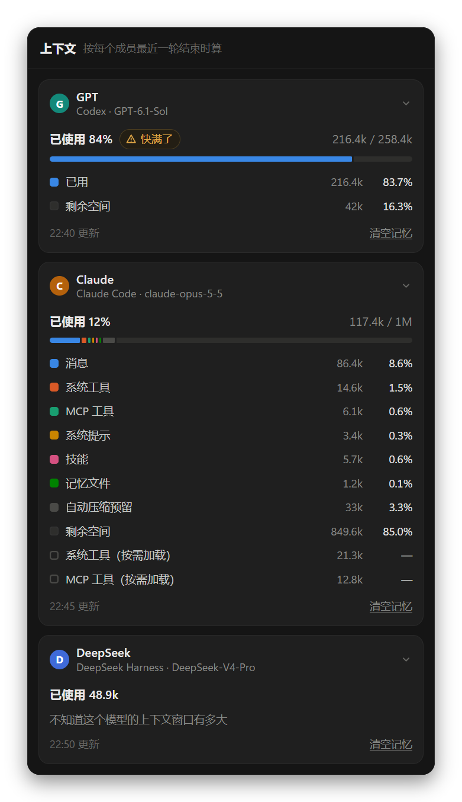

<div align="center">

<picture>
  <source media="(prefers-color-scheme: light)" srcset="build/icon-day.png">
  
</picture>

# Nightshift

让多个 AI 在同一个项目里协作

<p><a href="https://github.com/Lauk1z/nightshift/releases/latest">下载 Windows 安装版</a> · <a href="README.en.md">English</a> · <a href="README.zh-Hant.md">繁體中文</a></p>

</div>

<picture>
  <source media="(prefers-color-scheme: light)" srcset="docs/screenshots/zh-Hans/main-light.png">
  
</picture>

把 Claude Code、Codex、OpenCode、Gemini CLI 这类命令行 AI，和 DeepSeek、通义千问这类 API 模型拉进同一个群聊。它们共用一个项目文件夹，用 @ 互相交接：你提需求，它们分工去做，你随时插话或叫停。

深色外观下叫 Nightshift，浅色下叫 Dayshift。

## 安装

1. 到 [Releases](https://github.com/Lauk1z/nightshift/releases/latest) 下载 `Nightshift-Setup-<版本>.exe` 安装（`-portable.exe` 是免安装版）。Windows 提示「已保护你的电脑」时，点「更多信息」→「仍要运行」。
2. 至少装好并登录一个 AI 工具：

| AI | 安装 | 登录 |
| --- | --- | --- |
| Claude Code | `irm https://claude.ai/install.ps1 \| iex` | `claude` |
| Codex | `npm install -g @openai/codex` | `codex login` |
| OpenCode | `npm install -g @opencode/cli` | `opencode auth login` |
| Gemini CLI | `npm install -g @google/gemini-cli` | `gemini`，或设置 `GEMINI_API_KEY` |
| Grok Build | `irm https://x.ai/cli/install.ps1 \| iex` | `grok login`，或设置 `XAI_API_KEY` |
| pi | `npm install -g @earendil-works/pi-coding-agent` | 在 `pi` 里输入 `/login` |
| Hermes Agent | `iex (irm https://hermes-agent.nousresearch.com/install.ps1)` | `hermes model` |
| DeepSeek Harness | `npm install -g @deepseek-ai/dsh` | 在成员设置里填 API Key，或设置 `DEEPSEEK_API_KEY` |
| API 模型 | 不用装 | 填接口地址、Key 和模型名 |

左下角的插头显示各工具能不能用。装了新工具后点「重新检测」，不用重启。

安装版会自动更新：新版本在后台下载好后，左下角出现「重启以完成更新」。免安装版不会自动更新。不想装 exe 的话，双击 `start.bat` 在浏览器里用（需要 [Node.js](https://nodejs.org/) 18 以上）。

## 开始使用

打开 Nightshift 就是一个新会话：写下需求发出去即可，不用先建文件夹。成员是这台电脑上装好的所有 AI，不分工；在输入框右下角选先发给谁，鼠标停在它上面可以换模型，下次新会话还按你选的来。文件放在 Nightshift 给这个会话建的文件夹里。左边栏的「新建会话」随时回到这里。

要在自己的代码上干活，点「新建项目」选一个文件夹。一个项目里可以开好几个会话，共用这个文件夹，每个会话有自己的成员和聊天记录。

消息里 `@谁`，谁就接着做；成员的回复里 @ 了别人，别人就被唤醒，没有人被 @ 时接力结束。比如：

- `@GPT 先出设计，写好后交给 @Claude 实现`
- `@所有人 说说你的想法`

没有 @ 任何人的消息，发给输入框右下角显示的成员。成员之间连续交接 10 轮（会话设置里可以改）会暂停，等你点「继续接力」。有成员出错时，排在它后面的先不做，可以让它再试一次或者跳过。

**成员需要你确认时**（在会话设置里选）：

- **人工审查**（默认）：成员 @用户 提问时，接力停在这里。直接回复它，或者点「批准，继续接力」。
- **自动执行**：先交给审查模型（会话里的成员，或者专门接入的模型，只读）。风险低的由它代你答复；高风险的操作、要你亲自动手的、它拿不准的才交给你。
- **全权代理**：不停下来，成员自己拿主意。

**附件**：把文件或文件夹拖进对话区，点输入框左下角的 +，或者直接在输入框里粘贴截图、复制的文件（Ctrl+V）。项目外的文件会复制一份到项目的 `.agentchat/attachments/` 里，所有成员都能读到，原文件不动。

## 界面

- **左边栏**：搜索、新建会话、新建项目，下面是项目和会话。会话可以置顶、拖动排序，右键是它的操作。
- **标题栏**：项目名、会话名 ▾（切换会话）、成员头像（成员面板），右边是右侧面板的五个页面。
- **右侧面板**：
  - **文件**：项目的文件树和预览（网页、Markdown、代码、图片、PDF……），成员改过的文件标着是谁改的。
  - **侧边对话**：单独问某个成员问题，只读，不进群聊。
  - **终端**：在项目文件夹里打开的 PowerShell。
  - **浏览器**：打开本机正在运行的网页，或者项目里的 `.html`。
  - **上下文**：每个成员在这个会话里的上下文用了多少，按它最近一轮结束时算。Claude Code 还分成消息、系统工具、MCP 工具、系统提示、技能这些类别；Gemini CLI、Grok、Hermes 不报告，看不到。快满了的成员可以在它的卡片上「清空记忆」，让它从头开始。
- 成员每轮新建或修改的文件列在消息底部，点一下就能预览。


<p align="center"></p>

## 成员

点标题栏里的成员头像，再点一个成员，可以改名字、职责、接入方式、模型、思考强度和权限。每个会话的成员各自独立。

<p align="center"></p>

- **模型和思考强度**：列表从各个工具自己读，选「默认」就沿用工具自己的设置。也可以在输入框右下角选成员时，鼠标停在成员上直接换模型。
- **权限**：只读、可改文件（默认）、完全权限（能运行任何命令，只在可信的项目里开）。每种工具具体怎么限制，成员设置里写着。
- **API 模型**：接入方式选「API 模型」，填接口地址（DeepSeek、通义千问、Kimi、本机 Ollama 有现成的）、Key 和模型名。要让它读写文件，模型得支持工具调用。「更多设置」里可以填上下文窗口：右侧面板的「上下文」按它算用了多少，窗口小的模型每轮送的聊天记录也少一些。

## 更多

- **技能**：输入 `/` 选这台电脑上装好的技能。成员自己的工具里没有这个技能时，会把技能说明附给它。
- **交付验收清单**：在会话设置里打开。成员交付时，按清单核对源代码、测试是否真的跑过并通过、EXE、日志和原有文件，结果做成一张卡片；启动测试交给你。
- **用量**：账户菜单里的「用量」按模型统计 token，有最近一年的热力图和各模型的明细。

<p align="center"></p>

## 数据

- 所有数据都在本机的 `%APPDATA%\Agent Chat\data`（网页版在 `data/`），账户菜单里的「打开数据文件夹」能直接打开。
- 删除会话或项目只删聊天记录，不动项目文件夹里的文件。不属于项目的会话连同它的文件夹一起删（放进回收站）。
- 服务只监听本机 `127.0.0.1`。安装版会连 github.com 检查更新，不带任何项目或聊天内容。

## 常见问题

**成员一直报错？** Nightshift 直接调用你电脑上的 `claude`、`codex` 这些命令，用的是它们自己的登录。先在命令行里确认 `claude -p "你好"` 能正常回答。

**AI 之间停不下来？** 点发送按钮位置的停止（■），或者在会话设置里调低「自动接力上限」。

**怎么刷新界面？** Ctrl+Shift+R，或者 ☰ 菜单里的「重新加载界面」。

## 开发

```bash
npm install
```

```bash
npm start
```

`npm start` 打开桌面版，`npm run web` 打开网页版，`npm test` 运行测试（不联网，也不调用 AI），`npm run dist` 打包到 `dist/`。

发新版本：改 `package.json` 里的 `version`，运行 `npm run dist`，在 GitHub 上新建 Release（标签是 `v` 加版本号），把 `Nightshift-Setup-<版本>.exe`、`latest.yml` 和 `.blockmap` 一起传上去，发布成正式版。漏传 `latest.yml` 的话，已经装好的 Nightshift 收不到这次更新。

界面文字用 `tr('简体中文原文')` 包起来。加了新文字后，运行 `node scripts/i18n-keys.js` 找出缺的英文翻译补进 `public/i18n/en.json`，再运行 `node scripts/i18n-hant.js` 生成繁体词典和繁体说明。界面改了以后，`npm run screenshots` 重新生成说明里的截图。
