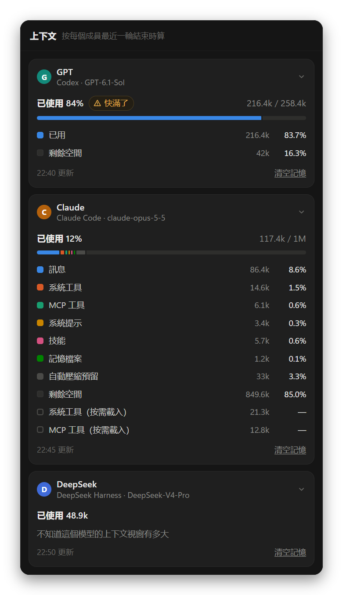

<div align="center">

<picture>
  <source media="(prefers-color-scheme: light)" srcset="build/icon-day.png">
  
</picture>

# Nightshift

讓多個 AI 在同一個專案裡協作

<p><a href="https://github.com/Lauk1z/nightshift/releases/latest">下載 Windows 安裝版</a> · <a href="README.md">简体中文</a> · <a href="README.en.md">English</a></p>

</div>

<picture>
  <source media="(prefers-color-scheme: light)" srcset="docs/screenshots/zh-Hant/main-light.png">
  
</picture>

把 Claude Code、Codex、OpenCode、Gemini CLI 這類命令列 AI，和 DeepSeek、通義千問這類 API 模型拉進同一個群聊。它們共用一個專案資料夾，用 @ 互相交接：你提需求，它們分工去做，你隨時插話或叫停。

深色外觀下叫 Nightshift，淺色下叫 Dayshift。

## 安裝

1. 到 [Releases](https://github.com/Lauk1z/nightshift/releases/latest) 下載 `Nightshift-Setup-<版本>.exe` 安裝（`-portable.exe` 是免安裝版）。Windows 提示「已保護你的電腦」時，點「更多資訊」→「仍要執行」。
2. 至少裝好並登入一個 AI 工具：

| AI | 安裝 | 登入 |
| --- | --- | --- |
| Claude Code | `irm https://claude.ai/install.ps1 \| iex` | `claude` |
| Codex | `npm install -g @openai/codex` | `codex login` |
| OpenCode | `npm install -g @opencode/cli` | `opencode auth login` |
| Gemini CLI | `npm install -g @google/gemini-cli` | `gemini`，或設定 `GEMINI_API_KEY` |
| Grok Build | `irm https://x.ai/cli/install.ps1 \| iex` | `grok login`，或設定 `XAI_API_KEY` |
| pi | `npm install -g @earendil-works/pi-coding-agent` | 在 `pi` 裡輸入 `/login` |
| Hermes Agent | `iex (irm https://hermes-agent.nousresearch.com/install.ps1)` | `hermes model` |
| DeepSeek Harness | `npm install -g @deepseek-ai/dsh` | 在成員設定裡填 API Key，或設定 `DEEPSEEK_API_KEY` |
| API 模型 | 不用裝 | 填API 位址、Key 和模型名 |

左下角的插頭顯示各工具能不能用。裝了新工具後點「重新檢測」，不用重啟。

安裝版會自動更新：新版本在背景下載好後，左下角出現「重啟以完成更新」。免安裝版不會自動更新。不想裝 exe 的話，雙擊 `start.bat` 在瀏覽器裡用（需要 [Node.js](https://nodejs.org/) 18 以上）。

## 開始使用

開啟 Nightshift 就是一個新會話：寫下需求發出去即可，不用先建資料夾。成員是這台電腦上裝好的所有 AI，不分工；在輸入框右下角選先發給誰，滑鼠停在它上面可以換模型，下次新會話還按你選的來。檔案放在 Nightshift 給這個會話建的資料夾裡。左邊欄的「新增會話」隨時回到這裡。

要在自己的程式碼上幹活，點「新增專案」選一個資料夾。一個專案裡可以開好幾個會話，共用這個資料夾，每個會話有自己的成員和聊天記錄。

訊息裡 `@誰`，誰就接著做；成員的回覆裡 @ 了別人，別人就被喚醒，沒有人被 @ 時接力結束。比如：

- `@GPT 先出設計，寫好後交給 @Claude 實現`
- `@所有人 說說你的想法`

沒有 @ 任何人的訊息，發給輸入框右下角顯示的成員。成員之間連續交接 10 輪（會話設定裡可以改）會暫停，等你點「繼續接力」。有成員出錯時，排在它後面的先不做，可以讓它再試一次或者跳過。

**成員需要你確認時**（在會話設定裡選）：

- **人工審查**（預設）：成員 @用户 提問時，接力停在這裡。直接回覆它，或者點「批准，繼續接力」。
- **自動執行**：先交給審查模型（會話裡的成員，或者專門接入的模型，只讀）。風險低的由它代你答覆；高風險的操作、要你親自動手的、它拿不準的才交給你。
- **全權代理**：不停下來，成員自己拿主意。

**附件**：把檔案或資料夾拖進對話區，點輸入框左下角的 +，或者直接在輸入框裡貼上截圖、複製的檔案（Ctrl+V）。專案外的檔案會複製一份到專案的 `.agentchat/attachments/` 裡，所有成員都能讀到，原檔案不動。

**改主意了**：

- 成員的回覆下面有「重新回答」：讓它換個思路把這一條再做一遍，原來那條留著。
- 你發的訊息可以「編輯重發」：改好後作為新訊息發出，原來那條標成「已修改」，成員以新的為準。
- 成員這一輪改了檔案的，回覆下面有「撤銷這一輪的改動」：新增的刪掉，改過的改回去，刪掉的放回來；之後又被改過的檔案不動，撤銷以後還能「恢復」。每輪開始前 Nightshift 把專案檔案存了一份（2 MB 以上的檔案不存，它們的改動撤銷不了）。

## 介面

- **左邊欄**：搜尋、新增會話、新增專案，下面是專案和會話。會話可以置頂、拖動排序，右鍵是它的操作。
- **標題欄**：專案名、會話名 ▾（切換會話）、成員頭像（成員面板），右邊是右側面板的五個頁面。
- **右側面板**：
  - **檔案**：專案的檔案樹和預覽（網頁、Markdown、程式碼、圖片、PDF……），成員改過的檔案標著是誰改的。
  - **側邊對話**：單獨問某個成員問題，只讀，不進群聊。
  - **終端機**：在專案資料夾裡開啟的 PowerShell。
  - **瀏覽器**：開啟本機正在執行的網頁，或者專案裡的 `.html`。
  - **上下文**：每個成員在這個會話裡的上下文用了多少，按它最近一輪結束時算。Claude Code 還分成訊息、系統工具、MCP 工具、系統提示、技能這些類別；Gemini CLI、Grok、Hermes 不報告，看不到。快滿了的成員可以在它的卡片上「清空記憶」，讓它從頭開始。
- 成員每輪新增或修改的檔案列在訊息底部，點一下就能預覽。


<p align="center"></p>

## 成員

點標題欄裡的成員頭像，再點一個成員，可以改名字、職責、接入方式、模型、思考強度和權限。每個會話的成員各自獨立。

<p align="center"></p>

- **模型和思考強度**：清單從各個工具自己讀，選「預設」就沿用工具自己的設定。也可以在輸入框右下角選成員時，滑鼠停在成員上直接換模型。
- **權限**：只讀、可改檔案（預設）、執行命令前問我（Claude Code 和 API 模型：要執行命令時先停下來，你點允許才執行）、完全權限（能執行任何命令，只在可信的專案裡開）。每種工具具體怎麼限制，成員設定裡寫著。
- **API 模型**：接入方式選「API 模型」，填API 位址（DeepSeek、通義千問、Kimi、本機 Ollama 有現成的）、Key 和模型名。要讓它讀寫檔案，模型得支援工具呼叫。「更多設定」裡可以填上下文視窗：右側面板的「上下文」按它算用了多少，視窗小的模型每輪送的聊天記錄也少一些。

## 更多

- **技能**：輸入 `/` 選這台電腦上裝好的技能。成員自己的工具裡沒有這個技能時，會把技能說明附給它。
- **交付驗收清單**：在會話設定裡開啟。成員交付時，按清單核對原始碼、測試是否真的跑過並通過、EXE、日誌和原有檔案，結果做成一張卡片；啟動測試交給你。
- **用量**：帳戶選單裡的「用量」按模型統計 token，有最近一年的熱力圖和各模型的明細。
- **搜尋聊天記錄**：左邊欄的搜尋打兩個字以上，下面會列出所有會話裡對得上的訊息，點一下跳到那一條。
- **匯出**：會話選單（右鍵左邊欄裡的會話，或者標題欄的 ⋯）裡的「匯出為 Markdown」，把整個會話存成一個檔案。

<p align="center"></p>

## 資料

- 所有資料都在本機的 `%APPDATA%\Agent Chat\data`（網頁版在 `data/`），帳戶選單裡的「開啟 data 資料夾」能直接開啟。
- 刪除會話或專案只刪聊天記錄，不動專案資料夾裡的檔案。不屬於專案的會話連同它的資料夾一起刪（放進資源回收筒）。
- 服務只監聽本機 `127.0.0.1`。安裝版會連 github.com 檢查更新，不帶任何專案或聊天內容。

## 常見問題

**成員一直報錯？** Nightshift 直接呼叫你電腦上的 `claude`、`codex` 這些命令，用的是它們自己的登入。先在命令列裡確認 `claude -p "你好"` 能正常回答。

**介面限流、服務太忙？** 還沒開始幹活就遇到的，Nightshift 會等一會兒（30 秒、2 分鐘、5 分鐘）自動重試，等的時候點停止就不等了。額度用完的不會重試。

**AI 之間停不下來？** 點傳送按鈕位置的停止（■），或者在會話設定裡調低「自動接力上限」。

**怎麼重新整理介面？** Ctrl+Shift+R，或者 ☰ 選單裡的「重新載入介面」。

## 開發

```bash
npm install
```

```bash
npm start
```

`npm start` 開啟桌面版，`npm run web` 開啟網頁版，`npm test` 執行測試（不聯網，也不呼叫 AI），`npm run dist` 打包到 `dist/`。

發新版本：改 `package.json` 裡的 `version`，執行 `npm run dist`，在 GitHub 上新增 Release（標籤是 `v` 加版本號），把 `Nightshift-Setup-<版本>.exe`、`latest.yml` 和 `.blockmap` 一起傳上去，釋出成正式版。漏傳 `latest.yml` 的話，已經裝好的 Nightshift 收不到這次更新。

介面文字用 `tr('簡體中文原文')` 包起來。加了新文字後，執行 `node scripts/i18n-keys.js` 找出缺的英文翻譯補進 `public/i18n/en.json`，再執行 `node scripts/i18n-hant.js` 生成繁體詞典和繁體說明。介面改了以後，`npm run screenshots` 重新生成說明裡的截圖。
