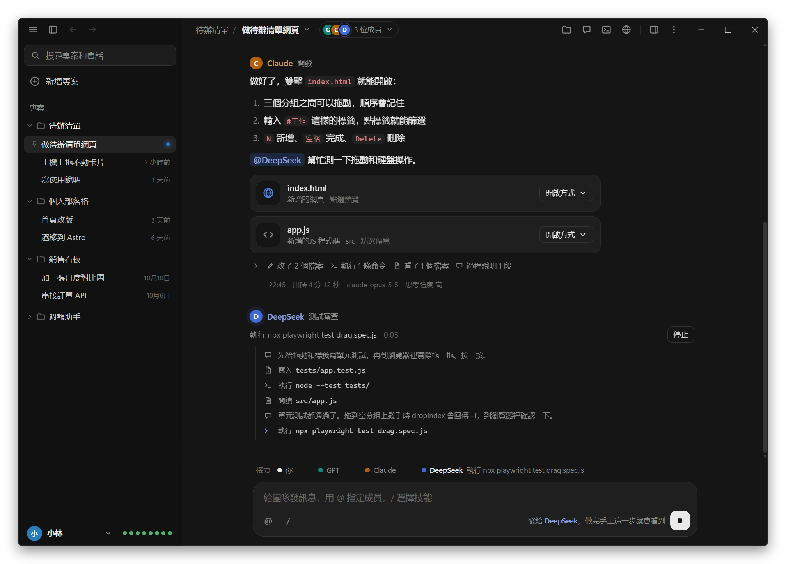
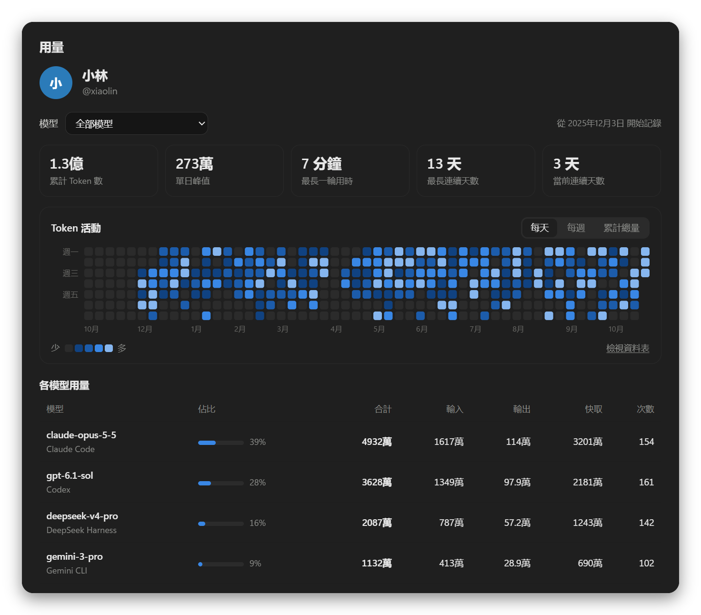
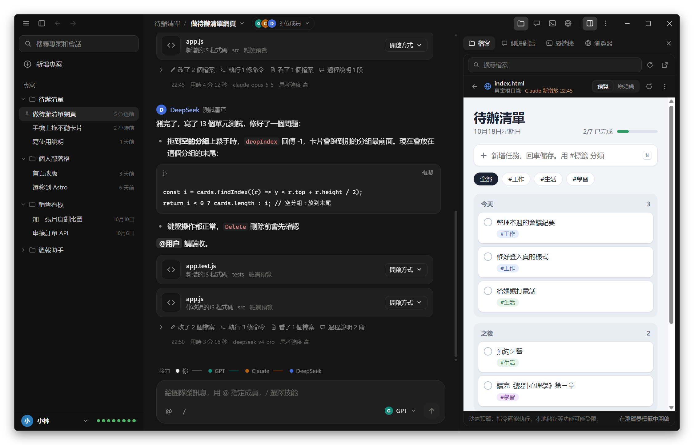
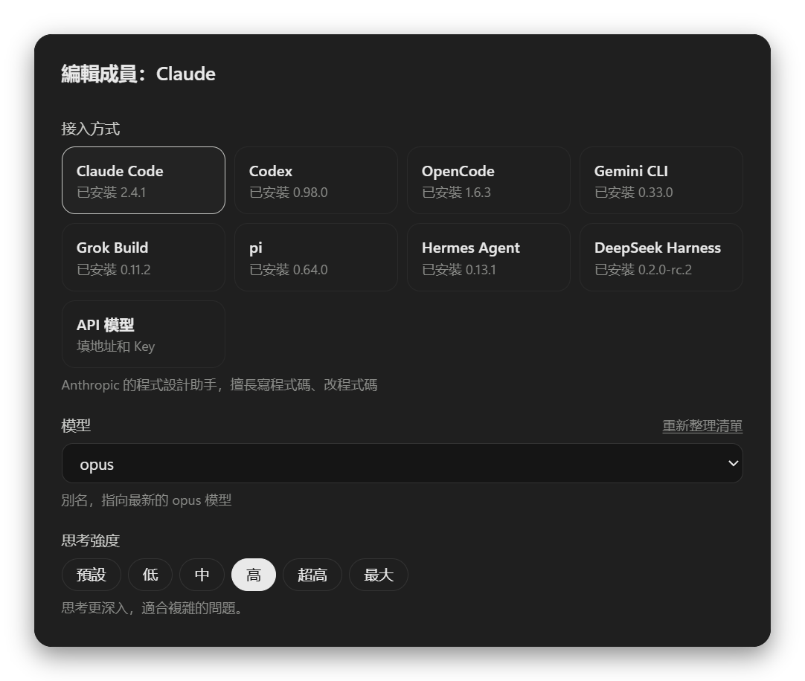

<div align="center">

<picture>
  <source media="(prefers-color-scheme: light)" srcset="build/icon-day.png">
  
</picture>

# Nightshift

讓多個 AI 在同一個專案裡協作

<p><a href="https://github.com/Lauk1z/nightshift/releases/latest">下載 Windows 安裝版</a> · <a href="README.md">简体中文</a> · <a href="README.en.md">English</a></p>

</div>

<picture>
  <source media="(prefers-color-scheme: light)" srcset="docs/screenshots/zh-Hant/main-light.png">
  
</picture>

把 Claude Code、Codex（ChatGPT）、OpenCode、Gemini CLI、Grok Build、pi、Hermes Agent、DeepSeek Harness，以及 DeepSeek、通義千問、Kimi 這類 API 模型拉進同一個「群聊」，讓它們共用一個專案資料夾、自己分工、互相交接。

你只要提需求，比如 `做一個待辦清單網頁，@GPT 先出設計，再交給 Claude 實現`。之後的流程是：

1. **GPT** 讀需求，把設計方案寫進 `docs/design.md`，在群裡 `@Claude 請按方案實現`
2. **Claude** 被喚醒，讀設計、寫程式碼，完成後 `@用户 請驗收`
3. 你看結果，隨時插話、指派、叫停

不用再在幾個 AI 之間來回複製貼上。

名字跟著外觀換：深色時叫 **Nightshift**（夜班，圖示是月亮裡亮著提示符 `>_`），你去睡覺，它們值夜班；切到淺色就變成 **Dayshift**（日班，圖示是太陽裡寫著 `>_`）。視窗標題、工作列圖示和「關於」裡的名字都會跟著變；exe、安裝包和開始選單裡的名字固定是 Nightshift。

<p>在 GitHub 上看這份說明也一樣：GitHub 是淺色外觀時，最上面的圖示和截圖就是 Dayshift。</p>

以前叫 Agent Chat。從舊版本升級不用做任何事：專案、聊天記錄和設定都還在原來的 data 資料夾裡。

## 安裝

到 GitHub 的 [Releases](https://github.com/Lauk1z/nightshift/releases/latest) 頁面下載安裝版。自己打包的話（見最後的「開發和打包」），`dist/` 資料夾裡會有下面兩個程式，選一個用：

| 檔案 | 用法 |
| --- | --- |
| `Nightshift-Setup-0.12.0.exe` | 安裝版。雙擊安裝，會在桌面和開始選單建快捷方式，以後會自動更新（見下一節）。推薦用這個。 |
| `Nightshift-0.12.0-portable.exe` | 免安裝版。雙擊直接執行，可以放在 U 盤裡隨身帶。每次啟動要先解壓，會比安裝版慢幾秒；不會自動更新。 |

程式沒有數字簽名，第一次執行時 Windows 可能提示「Windows 已保護你的電腦」。點「更多資訊」→「仍要執行」即可。

不想用 exe 的話，雙擊 **`start.bat`** 也行。它會在瀏覽器裡開啟同樣的介面（需要裝 [Node.js](https://nodejs.org/) 18 或更新版本）。

還需要至少一個 AI。命令列工具裝好、登入好以後，在命令列裡能直接執行就行：

| AI | 怎麼裝（Windows） | 裝好以後 |
| --- | --- | --- |
| Claude Code | PowerShell 裡執行 `irm https://claude.ai/install.ps1 \| iex` | 執行一次 `claude` 登入 |
| Codex | `npm install -g @openai/codex` | 執行一次 `codex login` |
| OpenCode | `npm install -g @opencode/cli` | 執行一次 `opencode auth login` 配好提供商 |
| Gemini CLI | `npm install -g @google/gemini-cli` | 執行一次 `gemini` 登入 Google 帳號，或者設定 `GEMINI_API_KEY` |
| Grok Build | PowerShell 裡執行 `irm https://x.ai/cli/install.ps1 \| iex` | 執行一次 `grok login`，或者設定 `XAI_API_KEY` |
| pi | `npm install -g @earendil-works/pi-coding-agent` | 執行一次 `pi`，用 `/login` 登入，或者設定對應提供商的 API Key |
| Hermes Agent | PowerShell 裡執行 `iex (irm https://hermes-agent.nousresearch.com/install.ps1)` | 執行一次 `hermes model` 選好提供商和模型 |
| DeepSeek Harness | `npm install -g @deepseek-ai/dsh` | 在成員設定裡填 DeepSeek 的 API Key，或者設定環境變數 `DEEPSEEK_API_KEY` |
| API 模型 | 不用裝 | 任何相容 OpenAI API的服務，填地址、Key 和模型名即可 |

左下角你的名字右邊的插頭圖示是這台電腦上的 AI 工具：點一下能看到每個工具能不能用、是什麼版本，沒裝的工具點一下會複製它的安裝命令。有工具版本太舊時，插頭右上角有一個琥珀色的點；一個工具都沒裝時是一個空心的點。

之後裝了新工具或者升級了版本，點插頭選單裡的「重新檢測」就行（帳戶選單裡也有），不用重啟 Nightshift：

- 它會重新讀取系統最新的 PATH，安裝程式剛加進去的資料夾也能找到。
- 它會讀一遍每個工具的 `--help`，只傳當前版本支援的參數和思考強度檔位。版本太舊的工具會顯示「版本太舊」並提示怎麼升級。
- 模型清單也會重新讀取。

換一臺電腦裝 Nightshift 也一樣：裝好 AI 工具後開啟 Nightshift，就能識別它們，並列出能選的模型和思考強度。那臺電腦上的 Claude Code 沒有自己的 `settings.json` 也沒關係，會列出 fable、opus、sonnet、haiku 這幾個通用別名。

## 自動更新

安裝版會自己更新，不用再去 Releases 下載：

1. 每次啟動十幾秒後，Nightshift 在背景去 GitHub 看有沒有新版本；一直開著的話，每 6 小時再看一次。
2. 有新版本就在背景下載，不影響手上的工作。
3. 下載好了，左下角你的名字上面會出現「重啟以完成更新」（帳戶選單和 ☰ 選單裡也有）。方便的時候點一下：Nightshift 會關掉，在背景裝好新版本，然後自動重新開啟。還有 AI 成員在工作的話，會先問你。

不點就不裝，平時關掉 Nightshift 也不會裝；下次啟動還會提示，已經下載好的不用重新下。

- 想馬上查一次：帳戶選單裡的「檢查更新…」。「關於」裡能看到當前版本和更新的狀態。
- 只有安裝版會自動更新。免安裝版、`start.bat` 網頁版和 `npm start` 都不檢查，新版本請到 [Releases](https://github.com/Lauk1z/nightshift/releases/latest) 下載。
- 更新只替換程式檔案。專案、聊天記錄和設定在 `%APPDATA%\Agent Chat\data`，不會動。
- 沒網、暫時連不上 GitHub、下載的檔案校驗不對，都不會彈窗打擾你，只記在日誌裡（`%APPDATA%\Agent Chat\logs\updater.log`），過一陣自動再試。「關於」裡會寫一句原因。
- 0.11.0 和更早的版本還沒有自動更新，要手動下載安裝一次新版本，之後就會自動更新了。

## 工作原理

| 概念 | 說明 |
| --- | --- |
| 專案 | 一個資料夾。專案裡可以開好幾個會話，它們的成員都在這個資料夾裡讀寫檔案，彼此的改動立刻可見。 |
| 會話 | 專案裡的一個群聊。每個會話有自己的成員、聊天記錄和設定，互不影響：比如一個會話讓 Claude 和 GPT 寫新功能，另一個會話讓 Gemini 專門修 bug。 |
| 成員 | 每個成員是一個 AI，有自己的名字、角色和職責說明，屬於某一個會話。命令列類 AI 會記住之前聊過的內容，下次只接收新訊息。 |
| @ 接力 | 訊息裡 `@誰`，誰就接著做。成員的回覆裡 @ 了別人，別人就被喚醒，AI 之間就是這樣自己交流的。沒有 @ 任何人時，接力自然結束。 |
| 預設接收人 | 你的訊息沒有 @ 人時交給誰。在輸入框右下角的成員按鈕裡選，「會話設定」裡也能改。如果有成員正在工作，就交給它。 |
| 自動接力上限 | AI 之間連續交接達到這個輪數（預設 10）會暫停，等你點「繼續接力」，防止它們無限地互相 @。 |
| 一次一個 | 成員按順序輪流執行，同一時間只有一個在改檔案，避免互相覆蓋。 |
| 出錯就暫停 | 某個成員執行出錯時，排在它後面的成員先不做。可以點「讓它再試一次」，成功後從這一步接著往下做；也可以「跳過，繼續接力」，或者「停止」。 |
| 需要你確認時 | 成員 @用户（要你拍板、提供資訊或驗收）時怎麼辦，見下一節。預設是「人工審查」：接力停下來等你。 |

### 成員需要你確認時

成員在回覆裡 @用户，就是有事要你確認：選方案、批准它執行某個程式、幫它在電腦上操作一下、驗收結果。在「會話設定」的「成員需要你確認時」裡選怎麼處理：

- **人工審查**（預設）：後面還有成員要接著做的話（原來排著隊的，或者這條回覆裡 @ 的），接力停在這裡，不會交給下一位。輸入框上方會寫明誰在等你。直接回覆就行，沒 @ 人的回覆交給問你的那位，它先做，排著的成員再接著往下。不用回覆的話，點「批准，繼續接力」讓排著的成員接著做，或者「停止」。
- **自動執行**：先把這件事交給審查模型。風險低的由它代你答覆，比如只在專案資料夾裡改檔案、執行專案裡的構建或測試指令碼、在幾個方案裡選一個。答覆以「自動審查」的名義發在群裡，問你的成員接著做。有高風險的操作（刪除或覆蓋檔案、改系統設定、安裝軟體、涉及帳號金鑰或付款、對外發布或推送），或者要你親自動手（在你電腦上執行、登入、提供 Key、親自驗收），或者它拿不準、出錯了，才交給你，接力像人工審查一樣停下來，輸入框上方寫著原因。
- **全權代理**：不用你批准，接力不會因為等你停下來。成員也會被告知儘量自己拿主意，只有缺少只有你能提供的東西時才 @用户。

審查模型可以用會話裡已有的成員，也可以點「接入專門的審查模型…」單獨接一個（接入方式和模型的選法和成員一樣，不參與接力）。它只讀：可以看專案檔案幫助判斷，不會改動任何東西。每次審查都是新的對話，用量記在「用量」裡。新增會話時，這些設定和成員一起照搬。

幾個常用寫法：

- `@GPT @Claude 各自看一下這個 bug`：兩人按順序輪流處理
- `@所有人 說說你的想法`：每位成員輪流發言
- 成員出錯或被中止時，訊息下面有「讓它再試一次」

每條訊息也會寫進專案資料夾裡的 `.agentchat/chat-<會話id>.md`（一個會話一個檔案），成員需要回顧早期討論時會去讀。這個資料夾自帶 `.gitignore`，不會被提交到 git。

## 專案和會話

專案就是一個資料夾，會話是在這個資料夾裡開的一個群聊。一個專案想分幾條線做（寫功能、修 bug、寫文件），就在裡面多開幾個會話，每個會話配不同的成員。只想隨手問點事、不想先建資料夾的話，也可以開一個不屬於哪個專案的會話。

- **新增會話（不用選資料夾）**：點左邊欄最上面的「新增會話」，馬上就建好並開啟。成員照搬你正在看的會話（它沒有成員時按「設計 + 開發」配），之後在標題欄的成員面板裡改。Nightshift 會在 data 資料夾的 `chats` 裡給它單獨建一個資料夾，成員讀寫的檔案都放在那裡，右側面板的「檔案」裡看得到。這樣的會話列在左邊欄的「會話」下面，標題欄裡只有會話名。正在看的就是這樣一個還沒發過訊息的會話時，再點「新增會話」不會多建一個空的。
- **新增專案**：選一個資料夾，再選第一個會話的成員：「設計 + 開發」「設計 + 開發 + 審查」，或者「空白」之後自己加。
- **在專案裡新增會話**：滑鼠移到左邊的專案上點 +，或者用標題欄會話名 ▾ 選單裡的「新增會話」，在彈出的視窗裡起名字、選成員。成員預設照搬當前會話的，模型、思考強度、權限都一樣；也可以選「設計 + 開發」這樣的團隊，或者「空白」。建好以後可以單獨改，不影響原來的會話。
- **會話名字**：新增時沒填名字的話，先叫「新會話」，你發第一條訊息時會用這條訊息自動起名字。想改就用會話名 ▾ 選單裡的「重新命名會話…」。
- **哪些是共用的**：同一個專案裡的會話共用專案資料夾和終端機；聊天記錄、成員、側邊對話、預設接收人、自動接力上限和交付驗收清單是每個會話自己的。
- **換資料夾**：在專案設定裡改，專案裡所有會話一起換過去，成員會從頭開始（重新讀一遍聊天記錄）。開著的終端機還停在舊資料夾裡，會一起關掉，新開的終端機在新資料夾裡。
- **會話的操作**：右鍵左邊欄裡的會話，或者滑鼠移上去點右邊的 ⋯：置頂 / 取消置頂、重新命名、會話設定、用相同的成員新增會話、刪除。「會話」下面的還有「在檔案總管中開啟」。右鍵專案彈出的是專案的操作。
- **置頂**：置頂的會話排在專案裡（或者「會話」下面）最前面，左邊有一個圖釘。
- **排序**：按住專案或會話拖到想要的位置，鬆手就記住了；拖的時候按 Esc 取消。會話只在自己的專案裡排（「會話」下面的就在「會話」裡排），置頂的和沒置頂的各排各的。用鍵盤的話，焦點在專案或會話上時按 Alt+↑ / Alt+↓ 挪一格。新增的專案和會話放在最上面。
- **刪除**：刪除會話只刪它的聊天記錄和成員設定；刪除專案會刪掉它裡面所有的會話。都不會動專案資料夾裡的檔案。不屬於專案的會話例外：它的資料夾是 Nightshift 建的，刪除會話時一起刪掉（放進資源回收筒）。

從 0.7 或更早的版本升級時，原來的每個專案會自動變成一個專案加一個會話，聊天記錄和成員都保留。用同一個資料夾的幾個舊專案會合併成一個專案（用資料夾的名字），原來的專案名留給裡面的各個會話。

## 介面

介面照著 Claude 桌面版的樣子做：近黑的底色（淺色模式是暖白），側邊欄和對話區一深一淺，內容放在帶細邊框的圓角卡片裡，對話在中間一欄。跟著系統的深淺色自動切換。

- **左邊欄**：最上面可以搜尋專案和會話，下面是「新增會話」（不用選資料夾）和「新增專案」，再往下是專案清單，不屬於專案的會話列在最後的「會話」下面。點專案名展開或收起它裡面的會話，會話右邊是最近一條訊息的時間，有成員在工作時是一個閃動的點，置頂的會話左邊有圖釘。滑鼠移到專案上，右邊會出現 +（新增會話）和 ⋯（專案設定、在檔案總管中開啟、複製資料夾路徑、刪除專案）；移到會話上，時間換成 ⋯（會話的操作）。右鍵也是同樣的選單。專案和會話都可以拖動排序（見上一節）。最底下是你的頭像和名字（點開是帳戶選單，見下一節），右邊的插頭是本機 AI 工具的狀態。
- **成員**：標題欄裡會話名的右邊是這個會話的成員頭像和人數，正在工作的成員頭像外有一圈在閃。點開是成員面板，每個成員一行：接入方式（Claude Code、Codex……）、模型、思考強度、權限，以及它正在工作還是在排隊。沒單獨選模型的，顯示那個工具自己設定裡的預設模型。點成員開啟它的設定，點「新增成員」加一個新的 AI。
- **對話**：你發的訊息是靠右的氣泡；成員的發言上面有頭像、名字和職責。滑鼠移到訊息上會出現「複製」按鈕；程式碼塊右上角也有「複製」。
- **對話軸**：對話區左邊的一排刻度（像 Codex 那樣），你發的每條訊息是一道，正在看的那一輪最長、最亮，有成員出錯的那一輪是紅色。滑鼠移到刻度上，附近的刻度會像放大鏡一樣一道道變長，划過去時後面拖著一條慢慢縮回的尾巴；旁邊的卡片顯示那一輪你說了什麼、最後誰回了什麼、有哪些成員接力，換刻度時卡片順著滑過去。點一下就跳到那條訊息。至少有兩輪對話時才出現；對話區太窄時會藏起來。
- **輸入框**：一張大圓角卡片。左下角的 @ 和 / 按鈕分別用來指定成員、選擇技能。右下角是選成員的按鈕（像 Claude 的模型選擇）：訊息沒有 @ 任何人時就發給它顯示的成員，點開能換成這個會話裡的其他成員，換了會記住；滑鼠停在一個成員上，旁邊會列出它能用的模型，點一下就換（下一輪開始用）；訊息裡 @ 了人，這裡就改成顯示發給誰。成員正在接力、輸入框又是空的時候，傳送按鈕會變成停止按鈕（■），點一下停止接力；打了字它又變回傳送。
- **接力條**：在輸入框正上方，顯示這一輪接力傳到了哪裡：做完的是實心點，正在做的會閃、連線上有流動的條紋，排隊的是空心點。

視窗沒有系統自帶的標題欄，標題欄和介面連成一體（最小化、最大化、關閉按鈕還是 Windows 自己的，拖動、雙擊最大化、貼靠佈局都照常）。標題欄從左到右是：

| 位置 | 作用 |
| --- | --- |
| ☰ | 選單：新增會話、新增專案、重新檢測 AI 工具、縮放、重新載入介面、開發者工具、檢查更新（安裝版）、關於 |
| 側邊欄圖示 | 收起或展開左邊的專案清單（Ctrl+B） |
| ← → | 在開啟過的會話之間上一頁、下一頁（Alt+← / Alt+→，滑鼠側鍵也行） |
| 專案名 | 專案的操作：新增會話、專案設定、在檔案總管中開啟、複製資料夾路徑、刪除專案（不屬於專案的會話沒有這一項） |
| 會話名 ▾ | 切換到同一個專案裡的其他會話（不屬於專案的會話切換的是「會話」下面那些），或者新增、重新命名會話，開啟會話設定 |
| 成員頭像 | 開啟這個會話的成員面板（見上） |
| 檔案、側邊對話、終端機、瀏覽器 | 開啟右側面板的對應頁面，再點一次收起 |
| 面板圖示 | 顯示或隱藏右側面板（Ctrl+J） |
| ⋮ | 會話設定、專案設定、在檔案總管中開啟、複製資料夾路徑，以及開啟右側面板的各個頁面 |

## 帳戶、設定和語言

點左下角的頭像和名字，會彈出帳戶選單（和 Claude 桌面版一樣）：

| 選單項 | 作用 |
| --- | --- |
| 設定（Ctrl+,） | 你的名字和頭像顏色、外觀（跟隨系統 / 淺色 / 深色）、介面語言、傳送鍵、桌面通知、data 資料夾 |
| 用量 | 各模型用了多少 token，見下一節 |
| 語言 | 簡體中文、繁體中文、English，選了馬上換 |
| 使用說明 | 就是這份說明 |
| 重新檢測 AI 工具 | 重新找這台電腦上的 Claude Code、Codex、OpenCode |
| 開啟 data 資料夾 | 專案、聊天記錄、設定和用量記錄都在裡面（exe 版），不屬於專案的會話的資料夾在裡面的 `chats` 裡 |
| 檢查更新… | 安裝版才有：馬上查一次新版本，結果在「關於」裡。新版本下載好以後，這一項變成「重啟以完成更新」（見「自動更新」） |
| 關於 | 版本號、更新的狀態、data 資料夾在哪 |

- 名字不填就用這台電腦的使用者名稱。它顯示在左下角和「用量」頁裡。
- 介面語言也是 AI 成員預設的回覆語言。你用別的語言跟它們說話時，它們會跟著換。新增專案時，成員的職責說明也按這個語言寫。
- 外觀在設定裡點一下就能看到效果，點「取消」會換回原來的。

## 用量

帳戶選單裡的「用量」按模型統計 token：成員每跑完一輪（群聊或側邊對話），這一輪用了多少都會記下來。

<p align="center"></p>

- 最上面是幾個數：累計 Token 數、單日峰值、最長一輪用時、最長連續天數、當前連續天數。
- 「Token 活動」是最近一年的圖，可以切換三種看法：
  - **每天**：熱力圖，一格一天，顏色越深用得越多。
  - **每週**：柱狀圖，一根柱子一週。
  - **累計總量**：一條往上走的線。
- 滑鼠停在格子、柱子或線上能看到具體的數；「檢視資料表」把圖換成表格。
- 下面是「各模型用量」：每個模型的合計、輸入、輸出、快取和次數。點一行（或者用最上面的「模型」下拉框）就只看這個模型，圖和上面的數也跟著變。

幾點說明：

- 「輸入」不含命中快取的部分，「快取」是讀快取和寫快取加起來，「輸出」包括思考用的 token。
- 各工具的用量來源：Claude Code 和 Codex 從它們的輸出裡讀；OpenCode 的輸出裡沒有用量，每輪結束後用 `opencode api` 再讀一次；API 模型從API 回傳的 `usage` 裡讀。
- 沒指定模型、工具也沒告訴 Nightshift 用的是哪個模型時，記成「預設模型」。
- 只統計在 Nightshift 裡跑的。你自己在命令列裡用這些工具，不會算進來。
- 用量記錄在 data 資料夾的 `usage.jsonl`。清空聊天記錄、刪除會話或專案都不會讓它變少。

## 右側面板

像 Claude、Codex 桌面版那樣從右邊展開，頂部有四個頁面。拖動面板左邊緣可以調寬度，雙擊恢復預設。視窗太窄時，面板會浮在對話上面。



**檔案**

- 專案資料夾的檔案樹。點資料夾展開，點檔案就在面板裡預覽。
- 「最近改動」列出成員新增或修改過的檔案，並標出是誰改的；樹裡改過的檔案後面有成員顏色的小圓點。
- 能預覽的：網頁（沙盒裡執行，可以切換「預覽 / 原始碼」）、Markdown（可以切換成原始碼）、程式碼和文字（帶行號）、圖片、PDF、音影片。不認識副檔名的檔案，只要是文字也能看。
- 成員改了你正在看的檔案，預覽會自動重新整理。
- 右鍵檔案或資料夾：用預設程式開啟、在資料夾中顯示、把路徑插入輸入框、複製路徑、在這個資料夾裡開啟終端機。
- 頂部的搜尋框按檔名找（輸入裡帶 `/` 時按路徑找），會跳過 `node_modules`、`.git` 這類資料夾。

**側邊對話**

單獨問某一位成員問題，比如「GPT 上一輪改了哪些檔案？為什麼？」。

- 只讀：不管這個成員平時是什麼權限，側邊對話裡都只能看檔案，不能改。
- 不進群聊，也不會喚醒別人。正在進行的接力不受影響，可以邊接力邊問。
- 每次提問都會帶上群聊的最新進展，所以能回答剛剛發生的事。
- 回答下面可以「複製」，或者「引用到群聊」（放進群聊輸入框，你再決定發不發）。

**終端機**

真正的終端機（Windows 上是 PowerShell，裝了 PowerShell 7 就用它），在專案資料夾裡開啟。可以開多個。終端機跟著專案走：同一個專案裡的會話共用這些終端機，切換專案時各專案的終端機各自保留。

- Ctrl+C：選中了文字就是複製，沒選中就是中斷正在執行的程式。Ctrl+V 貼上，右鍵有複製、貼上、清除畫面。
- 終端機裡輸出的網址可以點，會在「瀏覽器」頁開啟。
- 滑鼠移到終端機的標籤上，能看到它開在哪個資料夾。
- Ctrl+` 開啟或收起終端機。

**瀏覽器**

內嵌的瀏覽器標籤，有上一頁、下一頁、重新整理、位址列和開發者工具。

- 起始頁會列出本機正在執行的網頁（比如 `npm run dev` 啟動的 `localhost:5173`）和專案裡的 `.html` 檔案，點一下就開啟。
- 專案裡的網頁用 `file://` 直接開啟，本地儲存等功能都能用；檔案預覽裡的「在瀏覽器標籤中開啟」也是這樣。
- 它用單獨的儲存，和 Nightshift 自己的介面隔開；網頁申請攝像頭、定位、通知等權限一律拒絕。
- 網頁版（`start.bat`）裡用的是嵌入頁面的方式，有些網站不允許被嵌入。

## 輸入框

- 輸入 `@` 選成員，輸入 `/` 選技能。選中後會變成一整塊帶顏色的標籤：成員用它自己的顏色，技能是灰色。退格一次就能刪掉整個標籤。
- 手動打完整個名字再按空格，也會變成標籤。
- Enter 傳送，Shift+Enter 換行。經常寫長訊息的話，可以在「設定」裡改成 Ctrl+Enter 傳送、Enter 換行。

## 用 / 選技能（skill）

輸入 `/` 會列出這台電腦上裝好的技能，並標出是哪個工具自帶的。會讀取這些位置：

| 來源 | 位置 |
| --- | --- |
| Claude Code | `~/.claude/skills`、`~/.claude/commands`、已安裝外掛裡的技能 |
| Codex | `~/.codex/skills`（含系統技能）、`config.toml` 裡啟用的外掛 |
| OpenCode | `~/.config/opencode/skill(s)` |
| Gemini CLI | `~/.gemini/skills` |
| Grok Build | `~/.grok/skills`（它也會直接用 Claude 的技能和通用技能） |
| pi | `~/.pi/agent/skills` |
| Hermes Agent | Hermes data 資料夾裡的 `skills` |
| DeepSeek Harness | `~/.dsh/skills`（它也會直接用通用技能） |
| 通用 | `~/.agents/skills` |
| 專案裡的 | 專案資料夾下的 `.claude/skills`、`.codex/skills`、`.opencode/skill(s)`、`.gemini/skills`、`.grok/skills`、`.pi/skills`、`.dsh/skills`、`.agents/skills` |

比如發 `@GPT /frontend-design 設計一個登入頁`：

- 接手的成員自己裝了這個技能時，會被告知直接用它。
- 它自己的工具裡沒有這個技能時（比如 Codex 沒有 Claude 的技能），Nightshift 會把技能說明（`SKILL.md`）附在給它的提示裡，所以每個成員都能用。

## 檔案卡片

成員這一輪新增或修改了檔案，訊息底部會列出檔案卡片，顯示檔名和型別。不管 AI 是用編輯工具還是用命令寫的檔案，都能發現：每輪開始前後，Nightshift 會對比一次專案資料夾。

- 點卡片：在右側面板的「檔案」頁裡預覽（網頁、Markdown、程式碼、文字、圖片、PDF 等）。Word、Excel、PPT 和壓縮檔直接用預設程式開啟。
- 「開啟方式」選單裡可以選：用預設程式開啟、選擇其他程式開啟（Windows 的「你要如何開啟這個檔案」）、在資料夾中顯示、複製檔案路徑。
- `.exe`、`.bat` 這類雙擊就會執行的檔案，為了安全，「開啟」時只會在資料夾中顯示它。
- 訊息裡寫的檔案連結，比如 `[index.html](/E:/test/index.html)`，也可以直接點開。連結指向別的專案資料夾裡的檔案時，照樣能預覽，檔名下面寫著它在哪個專案裡；哪個專案都不在的檔案沒法預覽，會說明原因，給出「在資料夾中顯示」和「複製完整路徑」。
- 網頁預覽執行在沙盒裡，網頁中的指令碼無法操作 Nightshift。

依賴和構建產物（`node_modules`、`dist`、`build` 等）和以 `.` 開頭的資料夾不會出現在卡片裡。

**成員說做完了，檔案卻不在專案裡**：每輪結束時 Nightshift 會核對一次，結果寫在訊息底部，也會附在給下一位成員的聊天記錄裡，所以隊友不會只憑一句「已經完成」就當真。

- 用編輯工具把檔案寫到了專案資料夾以外：訊息底部提醒「有 N 個檔案寫到了專案資料夾以外」，列出這些路徑，工作過程裡對應的那一步標著「專案外」。用命令寫到外面的檔案發現不了。
- 能改檔案的成員這一輪什麼檔案都沒改：顯示一行小字「這一輪沒有改動專案資料夾裡的檔案」。只讀的成員不顯示。
- 協作規則裡也要求成員：檔案都放在專案資料夾裡；說做完之前先確認檔案確實在，說測試通過之前要真的執行過。

要在交付時把原始碼、測試、EXE、日誌這些一起核對一遍，開啟下面的「交付驗收清單」。

## 交付驗收清單

讓成員做一個完整的專案、最後交給你驗收時（比如寫一個小程式再打包成 EXE），可以在「會話設定」裡開啟**交付驗收清單**。開啟以後，成員說做完了、把成果交給你時，Nightshift 會按清單逐項核對實際的檔案和工具記錄，結果做成一張卡片放在那條訊息下面，不只聽成員說「都完成了，測試全部通過」。預設是關的，每個會話單獨設定。

什麼時候核對：成員在最終回覆裡寫了交付報告；或者接力到它這裡結束（沒有 @ 別的成員接著做），並且說做完了、請你驗收。只是交接給隊友、向你提問的訊息不核對，普通聊天不受影響。

| 清單 | Nightshift 怎麼核對 |
| --- | --- |
| 原始碼已建立，路徑在專案資料夾裡 | 報告裡寫的原始碼檔案在不在、是不是在專案資料夾裡；這次任務新增或修改了哪些原始碼；有沒有檔案寫到了專案資料夾以外 |
| 自動化測試實際執行並通過 | 只認這次任務的工具記錄裡真的執行過的測試命令（pytest、unittest、npm test、go test 這類，或者用 python、node 執行測試檔案），以及那一步是成功還是失敗。沒執行過、只是說通過了的不算；測試之後又改了程式碼的，要重新執行 |
| EXE 和所需依賴檔案實際存在 | 報告裡寫的可執行檔案和依賴檔案在不在；EXE 是不是有效的 Windows 程式、是不是空檔案、是不是比最後一次改程式碼還早（改完程式碼沒有重新打包）。沒寫報告時在 dist、build 這些資料夾裡找。這次交付沒有可執行檔案的，這一項不涉及 |
| 在 Windows 上完成啟動測試 | Nightshift 不會替你執行成員做的程式，所以這一項總是交給你：卡片上寫著成員說的啟動測試情況、誰在命令裡啟動過它。點檔名能在資料夾中找到 EXE，你雙擊試過以後點「通過」或「不通過」 |
| 日誌和交付清單已經生成 | 報告裡寫的日誌和交付清單檔案在不在；沒寫報告時在專案裡找 `.log`、`logs/`、`DELIVERY.md`、`交付清單.md` 這類檔案。不是這次任務裡生成的也算有，但會寫明 |
| 專案原有檔案沒有被意外刪除或覆蓋 | 和任務開始時的專案資料夾對比：刪掉了原有檔案就是沒通過；改了原有檔案，或者有成員執行過刪除檔案的命令，交給你確認是不是有意的 |
| 文字沒有變成問號或亂碼 | 檢查這次改動的文字檔案裡有沒有一串串問號（中文用不支援的編碼儲存就會變成這樣）、亂碼字元，以及不是 UTF-8 編碼的檔案 |

每一項的結果是 ✓ 通過、✗ 沒通過、? 待你確認或 – 不涉及，下面寫著依據，點檔名可以預覽或者在資料夾中顯示。「待你確認」的項右邊有「通過」「不通過」，再點一次就是取消。核對靠的是檔案和命令的特徵，難免有看錯的時候：你確認沒通過的某一項其實沒問題，點它右邊的「仍然通過」（可以撤銷）。

- **交付報告**：開啟清單以後，每一輪都會告訴成員清單的內容和交付報告的格式：原始碼、測試命令、可執行檔案、依賴檔案、啟動測試、日誌、交付清單、可以清理的中間產物，每項一行，沒有的寫「無」。成員沒按格式寫時，Nightshift 自己在專案裡找，卡片上會註明。
- **結果給誰看**：卡片的內容（連同你點的通過 / 不通過）會附在給下一位成員的聊天記錄裡，交付的那位成員下一輪也看得到，所以直接 @ 它「按清單把沒通過的修好」就行。專案裡的聊天記錄檔案也會寫上。
- **不會刪除任何檔案**：Nightshift 核對時只讀不寫，也要求成員不要刪除檔案。構建中間產物（`build/`、`__pycache__/`、`*.spec` 這類）要清理的話，成員列在報告的「可以清理的中間產物」裡，卡片上會列出來；點「批准清理…」會把批准的話放進輸入框，你看過再發給成員。
- **任務從哪裡算起**：沒有成員在工作時你發的訊息，開始一次新任務。Nightshift 記下任務開始時專案資料夾的樣子，用來核對原有檔案；開啟了清單的會話會把它存下來，中途重啟 Nightshift 也不丟。依賴、構建產物和 `.` 開頭的資料夾不在核對範圍內。
- **只核對做沒做，不評判做得好不好**：測試只能確認命令真的執行了、結果是成功；測試寫得夠不夠、程式用起來對不對，還要你自己看。用命令寫到專案外的檔案也發現不了。
- 想讓成員自己跑測試、打包，要給它能執行命令的權限（見下面的「權限」）。

## 給每個成員選模型和思考強度

點標題欄裡的成員頭像開啟成員面板，再點一個成員開啟它的設定，「接入方式」下面就是「模型」和「思考強度」。每個成員單獨設定，互不影響，不同會話裡的成員也是各自獨立的。比如設計用 GPT-6-Luna 配「低」，開發用 deepseek-v4-pro 配「高」。

<p align="center"></p>

模型清單從各個工具自己那裡讀取，你在那邊換了設定，這裡點「重新整理清單」就能看到：

| 接入方式 | 模型清單來自 | 思考強度怎麼傳給它 |
| --- | --- | --- |
| Claude Code | `~/.claude/settings.json` 裡的模型選項，加上 fable、opus、sonnet、haiku 四個別名 | `--effort`，再用 `--settings` 覆蓋設定檔案裡的 `CLAUDE_CODE_EFFORT_LEVEL`，否則設定檔案會把它蓋掉 |
| Codex | `codex debug models`，每個模型有自己能選的檔位 | `-c model_reasoning_effort=…` |
| OpenCode | `opencode api model.list`，按提供商分組 | `-m 提供商/模型#檔位`，所以要先選具體模型才能選檔位 |
| Gemini CLI | 它認的幾個別名：auto、pro、flash、flash-lite（具體的模型名可以自己輸入），預設模型在 `~/.gemini/settings.json` | 不能在命令列裡單獨設定，用 Gemini CLI 自己的設定 |
| Grok Build | `grok models` | `--effort` |
| pi | `pi --list-models`，按提供商分組，只列出已經登入或配好 Key 的提供商 | `--thinking`，超過模型支援的檔位會自動降下來 |
| Hermes Agent | 只讀出它設定裡的預設模型（模型在 Hermes 裡用 `hermes model` 選），也可以自己輸入模型名 | `--reasoning` |
| DeepSeek Harness | 它自帶的 deepseek-flash（預設）和 deepseek-v4-pro；在 dsh 裡接的別家提供商寫成「提供商/模型」 | 每次用一個臨時的 `--patch` 改 `agent-default-model` 的 `reasoningEffort`（off / low / high / max）。它在建會話時就定下模型，所以改了模型、思考強度或權限，下一輪會換新會話 |
| API 模型 | 介面的 `/models`（點「取得模型清單」） | 請求裡的 `reasoning_effort`；各家特有的開關寫在「額外請求參數」裡 |

選「預設」就是不額外指定，沿用那個工具自己的設定。每條訊息底部會記下這次用的模型和思考強度。

只想換模型的話，不用開啟成員設定：點輸入框右下角選成員的按鈕，滑鼠停在成員上，旁邊就是它的模型清單。原來的思考強度新模型不支援時，會自動改回「預設」。

幾點說明：

- 清單裡標「舊版」的 Codex 模型已經有新版替代，有些帳號用不了。比如用 ChatGPT 帳號登入時不能用 gpt-5.5，會直接報錯。
- 思考強度越高，回答越慢，也越耗用量。簡單的交接、打招呼用「低」就夠了。

## 權限

每個成員可以單獨設定：

| 接入方式 | 只讀 | 可改檔案（預設） | 完全權限 |
| --- | --- | --- | --- |
| Claude Code | 只能讀檔案 | 能改檔案，不能執行命令 | 能執行任何命令 |
| Codex | 只讀沙箱 | 能改檔案，命令在沙箱裡跑 | 關閉沙箱 |
| OpenCode | plan 模式 | 按 OpenCode 自己的設定 | 自動批准一切 |
| Gemini CLI | 需要確認的工具一律不執行 | 自動批准改檔案，不能執行命令 | yolo 模式，自動批准一切 |
| Grok Build | dontAsk 模式，只放行只讀的工具和命令 | 自動批准改檔案，需要確認的命令不執行 | always-approve，自動批准一切 |
| pi | 只給 read、grep、find、ls | 再加上 edit、write，不能執行命令 | 預設工具，能執行任何命令 |
| Hermes Agent | 去掉命令列工具，並要求它不改檔案（Hermes 沒有隻讀的檔案工具，無法完全限制） | 預設工具，危險的命令沒人批准就不執行 | `--yolo`，危險的命令也直接執行 |
| DeepSeek Harness | 只讀沙箱（`DSH_PERMISSION_MODE=read-only`） | 能改專案資料夾裡的檔案，命令在沙箱裡執行；需要批准的操作不執行 | 關閉沙箱（`danger-full-access`） |
| API 模型 | 只能列出、讀取檔案 | 能讀寫檔案 | 還能執行命令 |

想讓負責開發的成員自己安裝依賴、跑測試，就把它設成「完全權限」。只在可信的專案裡這樣做。

## 接入 API 模型

「新增成員」時選擇 **API 模型**，然後：

1. 從「常用服務」裡選一個地址，或者自己填寫：
   - DeepSeek：`https://api.deepseek.com/v1`
   - 通義千問（阿里雲百鍊）：`https://dashscope.aliyuncs.com/compatible-mode/v1`
   - Kimi：`https://api.moonshot.cn/v1`
   - 本機 Ollama：`http://127.0.0.1:11434/v1`
2. 填 API Key 和模型名

API 模型本身不會讀寫檔案，Nightshift 會給它一組只能在專案資料夾內使用的檔案工具。這需要模型支援工具呼叫（function calling）。如果模型不支援，在成員設定裡取消勾選「讓它能讀寫專案檔案」，它就只參與討論。

DeepSeek 的新模型有時會把工具呼叫直接寫成文字（DSML 格式，像 `<｜DSML｜function_calls>` 這樣），API 沒把它轉成工具呼叫。Nightshift 會認出來照樣執行，介面上不顯示這段標記；寫得不完整的會報錯，不會當成已經回答了。

## 資料和隱私

- 專案、會話、聊天記錄、成員設定、設定和用量記錄都儲存在本機。API Key 也只存在這裡：
  - exe 版：`%APPDATA%\Agent Chat\data`（安裝版和免安裝版共用；沿用改名前的資料夾，所以升級後資料都還在）
  - `start.bat` 網頁版：本目錄的 `data/`
- exe 版也是在程式內部啟動一個只監聽本機 `127.0.0.1` 的服務，並會拒絕來自其它網站的請求
- 專案存在 `data/projects/<專案id>/project.json`；會話存在 `data/rooms/<會話id>/`，成員設定在 `room.json`，聊天記錄在 `messages.jsonl`
- 刪除會話或專案只會刪除上面這些記錄，不會動你的專案資料夾
- exe 版視窗不在前景時，成員 @ 你、出錯或接力結束會彈出 Windows 通知
- 側邊對話存在 `data/rooms/<會話id>/side.jsonl`，不會寫進專案資料夾裡的聊天記錄
- 設定存在 `data/settings.json`，用量記錄存在 `data/usage.jsonl`（只有數字、模型名和成員名，沒有對話內容）
- 內建終端機用你自己的權限執行，和你自己開啟的 PowerShell 一樣；關閉 Nightshift 時會一起關掉
- 安裝版會連到 github.com 檢查、下載新版本（見「自動更新」）。請求裡沒有專案、聊天記錄或帳號資訊，只帶一個隨機編號（electron-updater 用來分批推送新版本，存在 `%APPDATA%\Agent Chat\.updaterId`）；下載的安裝包暫存在 `%LOCALAPPDATA%\agent-chat-updater`

## 常見問題

**成員一直報錯，提示認證失敗或連不上？**
Nightshift 直接呼叫你電腦上的 `claude`、`codex`、`opencode`、`gemini`、`grok`、`pi`、`hermes`、`dsh` 命令，用的是它們自己的登入和設定。先在命令列裡確認 `claude -p "你好"`、`gemini -p "你好"` 這類命令能正常回答。

**「Claude」成員實際用的是什麼模型？**
看訊息底部顯示的模型名。不指定模型時，取決於 Claude Code 自己的設定（`~/.claude/settings.json`）。如果你用 CC Switch 這類代理把 Claude Code 轉到了別的模型，這裡也會跟著變。

**關掉視窗時還有成員在工作？**
會先問你要不要停止。確定後會停掉它們再結束。

**AI 之間停不下來？**
點「停止接力」。也可以在會話設定裡調低「自動接力上限」。

**按 Ctrl+R 沒有重新整理介面？**
因為終端機裡的 Ctrl+R 是搜尋歷史命令，重新整理介面改成了 Ctrl+Shift+R，或者用 ☰ 選單裡的「重新載入介面」。

**用量和工具自己顯示的對不上？**
「用量」只算在 Nightshift 裡跑的那些輪。另外各家算快取的方式不一樣，Nightshift 統一成「輸入（不含快取）+ 快取 + 輸出」，加起來的總數可能和工具自己的說法略有出入。

**網頁版想換埠？**
執行 `node server/index.js --port 4000 --open`。

**自動更新一直沒動靜？**
開啟「關於」看「更新」那一行，寫著現在的狀態或者沒成功的原因（沒聯網、GitHub 限流、最新的 Release 裡沒有 `latest.yml`……），詳細的記錄在 `%APPDATA%\Agent Chat\logs\updater.log`。免安裝版和網頁版不會自動更新。

## 開發和打包

```bash
npm install
```

```bash
npm start
```

`npm start` 用 Electron 開啟桌面版，`npm run web` 開啟網頁版。

```bash
npm test
```

執行測試，不需要聯網，也不會呼叫真實的 AI。

```bash
npm run dist
```

重新打包，在 `dist/` 裡生成安裝版和免安裝版 exe，還有自動更新要用的 `latest.yml` 和 `Nightshift-Setup-<版本>.exe.blockmap`。它只打包，不會上傳到 GitHub。打包前會自動把終端機介面用的 xterm.js 複製到 `public/vendor/`（`npm run vendor`）。圖示由 `npm run icon` 生成（`scripts/make-icon.js`）。

發新版本：

1. 改 `package.json` 裡的 `version`。自動更新按它判斷新舊，必須比上一個版本大（比如 0.11.0 → 0.12.0）。
2. 執行 `npm run dist`。
3. 在 GitHub 上新增 Release，標籤寫成 `v` 加版本號（比如 `v0.12.0`），把 `dist/` 裡這次生成的下面幾個檔案一起傳上去，然後直接釋出成正式版。自動更新只認最新的正式版（Latest），草稿和預釋出版（pre-release）都不算。

| 檔案 | 用途 |
| --- | --- |
| `Nightshift-Setup-<版本>.exe` | 安裝版。自動更新下載的也是它 |
| `latest.yml` | 已經裝好的 Nightshift 靠它知道最新的版本號、安裝包的檔名和校驗值。**漏傳它，大家就收不到這次更新**（「關於」裡會顯示「GitHub 上最新的版本還沒有提供自動更新」） |
| `Nightshift-Setup-<版本>.exe.blockmap` | 增量更新用：下次更新時，裝著這個版本的電腦只下載和它不同的部分，不用整個重新下。漏傳也能更新，只是要下載整個安裝包（100 多 MB） |
| `Nightshift-<版本>-portable.exe` | 免安裝版（可選） |

`latest.yml` 和 `.blockmap` 每次都要傳這次 `npm run dist` 生成的那一份，不能拿舊的改。以前發版只傳了安裝包，所以 0.11.0 和更早的版本收不到自動更新，要手動裝一次新版本。

內建終端機用的是 [@lydell/node-pty](https://www.npmjs.com/package/@lydell/node-pty)（自帶編譯好的檔案，不需要裝編譯工具）。

```
electron/
  main.js           桌面版主程序：啟動服務、沉浸式標題欄、內嵌瀏覽器、選資料夾、通知、關閉前提醒
  updater.js        自動更新（electron-updater，更新源是 GitHub Releases，只在安裝版裡檢查）
  preload.js        給介面開放的幾個原生功能
server/
  index.js          HTTP 服務、介面、SSE 推送；start() 供桌面版呼叫
  orchestrator.js   接力排程：排隊、@ 路由、自動上限、停止
  side.js           側邊對話：單獨問某個成員，只讀、不進群聊
  settings.js       應用設定（名字、外觀、語言、傳送鍵、通知）
  usage.js          token 用量記錄和彙總
  i18n.js           服務端給使用者看的文字（報錯、系統訊息）跟著設定裡的語言
  terminal.js       內建終端機（node-pty），輸出透過 SSE 推給介面
  prompt.js         協作協議和提示詞、@ 解析
  models.js         讀取各家工具的模型清單和思考強度檔位
  skills.js         讀取本機裝好的技能，並把技能說明交給成員
  files.js          每輪前後對比專案檔案（檔案卡片），檔案樹和搜尋，開啟檔案、在資料夾中顯示
  store.js          本地儲存：專案、會話、聊天記錄；舊版的資料在這裡升級
  proc.js           Windows 下可靠地啟動 / 結束命令列工具
  adapters/         各家 AI 的接入：claude、codex、opencode、gemini、grok、pi、hermes、dsh（DeepSeek Harness）、openai（相容介面）
public/             介面（原生 JS，無構建步驟）
  app.js            主介面：標題欄、專案和會話、成員面板、群聊、輸入框
  panel.js          右側面板：檔案、側邊對話、終端機、瀏覽器
  account.js        左下角的帳戶選單、設定、用量頁、自動更新的提示
  i18n.js           介面語言：按簡體中文原文查詞典
  i18n/             詞典：en.json（手寫）、zh-Hant.json（由 scripts/i18n-hant.js 生成）
  vendor/xterm/     終端機介面（xterm.js，由 scripts/vendor.js 複製過來）
scripts/make-icon.js 生成應用圖示
scripts/vendor.js   複製 xterm.js 到 public/vendor
scripts/i18n-*.js   翻譯用：找出沒翻譯的文字、檢查詞典、生成繁體詞典
scripts/screenshots/ 生成 README 的截圖（npm run screenshots）
test/run.js         測試
```

介面上的文字都用 `tr('簡體中文原文')` 包起來，英文和繁體按原文查 `public/i18n/` 裡的詞典。加了新文字以後：

```bash
node scripts/i18n-keys.js
```

它會列出 `en.json` 裡還缺的翻譯（補上即可），然後執行 `node scripts/i18n-hant.js` 重新生成繁體詞典和繁體的使用說明（需要先 `npm install`，用到 opencc-js）。`npm test` 也會檢查詞典是否齊全。

使用說明有三份，帳戶選單裡的「使用說明」按介面語言顯示：`README.md`（簡體，以它為準）、`README.en.md`（英文，改了簡體版要跟著改）、`README.zh-Hant.md`（繁體，生成的，不要手改）。只給 GitHub 看的內容（最上面的圖示、截圖、語言連結）寫成單獨一行的 HTML，介面裡的「使用說明」會去掉這些行；截圖放在 `docs/screenshots/<語言>/`。

介面改了以後執行 `npm run screenshots` 重新生成這些截圖：它用演示資料和替身命令列工具啟動桌面版來截圖，不碰真實的資料和設定，也不呼叫 AI；只想重拍其中幾張，就在後面寫上圖名或語言，比如 `npm run screenshots -- usage en`。

要接入新的 AI 工具，在 `server/adapters/` 里加一個檔案，實現 `run({ agent, cwd, prompt, sessionId, emit })`，返回 `{ done, cancel }`。可以參照 `codex.js`。
